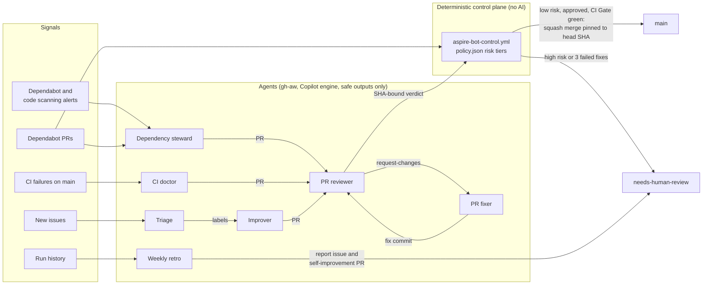

# Aspire Bot

Aspire Bot keeps `microsoft/aspire-samples` healthy on its own. It triages issues, turns
Dependabot and code scanning alerts into fixes, diagnoses CI failures, reviews and fixes its own
pull requests, merges low-risk changes, and runs a weekly retrospective to improve itself.

Humans control everything with **one repository variable**.

## The kill switch: `ASPIRE_BOT_MODE`

Set it under **Settings → Secrets and variables → Actions → Variables**.

| Value | What happens |
|---|---|
| `active` | The full loop runs. Agents open, review, and fix pull requests. The control plane merges eligible low-risk pull requests. |
| `paused` | Monitoring only. Agents still run and analyze, but pull request, push, review, and comment outputs are **staged**: previewed in the run summary, never written. Triage labels, CI-failure issues, the weekly retro issue, and the status issue still update. Nothing is merged. |
| `stopped` | Every agent workflow skips at its first job. The control plane merges nothing and only removes stray `auto-merge` labels from bot and Dependabot pull requests. |
| unset or anything else | Treated as `stopped`. |

Mode changes take effect on each workflow's next run. Staged outputs re-read the variable when
they execute, so switching away from `active` also blocks writes from runs already in flight.
The control plane checks the mode at the moment it merges, so nothing merges after you leave
`active`. No GitHub auto-merge is ever left enabled on bot or Dependabot pull requests.

To stop work on one item, add the `aspire-bot:hold` label to it.

## How it works

### Separation of powers

- **Agents can't merge.** They write only through gh-aw safe outputs, which are restricted by
  file allowlists and labels and run under the Aspire Bot GitHub App. They can't add
  `auto-merge` or approve anything.
- **The control plane** (`scripts/aspire_bot.py`, run by `aspire-bot-control.yml`) is the only
  automation that merges bot or Dependabot pull requests. It's deterministic, unit tested, and
  always runs from the default branch (`pull_request_target`, `schedule`, and `workflow_run`), so a
  pull request can't change its own gate. Every agent workflow also runs only from default-branch
  triggers, so no pull request can run a modified agent with the App credentials.
- **The merge is atomic.** The control plane calls the merge API with `sha` set to the head commit
  it classified, saw approved, and saw pass **CI Gate**. If anyone pushes in between, GitHub
  refuses the merge, and the new commit needs a new review. It never enables GitHub auto-merge,
  because that would also cover later pushes. The existing `.github/policies/auto-merge.yml`
  label still works for maintainers' own pull requests.

### Merge rules

An Aspire Bot or Dependabot pull request is merged only when all of these are true:

1. The mode is `active`.
2. The pull request isn't a draft.
3. It targets the default branch.
4. It has no `aspire-bot:hold` label.
5. Every changed file is **low risk** under `policy.json` (see below).
6. **Aspire Bot pull requests only:** the reviewer's latest verdict is `approve` and is bound to the
   current head SHA. Any new push requires a new review.
7. **Dependabot pull requests only:** the reviewer has not requested changes on the head commit.
8. **CI Gate** succeeded on the head commit.

A verdict counts only when it's the newest Aspire Bot review on the head commit, its footer is the
last two lines, and neither marker appears anywhere else in the review.

Human-authored pull requests are never merged or relabeled.

### Risk tiers (`policy.json`)

Rules are evaluated in order; the first match wins, and unmatched files are high risk.

- **Always high (human review required):**
  - Aspire Bot itself.
  - Workflows, policies, `dependabot.yml`, `CODEOWNERS`, and `build/**`.
  - Sample source code.
- **Low:**
  - Markdown docs.
  - **Version-only** edits to `*.csproj`, `Directory.*.props`, `global.json`, `package.json`, Go,
    Maven, and Python manifests, and the pinned versions in `ci.yml`. A version-only edit is one where
    every changed line is identical except for a well-formed version number, so swapping a package
    source (for example, a git URL in `package.json`) is high risk.
  - Lockfiles, unless an added line points at an untrusted source (git, file, or link protocols, or
    a `resolved` URL outside the public registry).

High-risk pull requests get the `needs-human-review` label and a comment explaining why.

## Workflows

| Workflow | Trigger | Writes (in `active` mode) |
|---|---|---|
| `aspire-bot-control.yml` | Every 10 minutes, pull request events, after reviewer, fixer, and CI runs | SHA-pinned squash merges, labels, the **Aspire Bot status** issue |
| `aspire-bot-triage.md` | Issue opened or reopened, daily sweep | Type labels, `aspire-bot:ready`, one clarifying comment |
| `aspire-bot-dependency-steward.md` | Weekdays | One pull request for an alert or a failing Dependabot PR |
| `aspire-bot-ci-doctor.md` | CI failure on `main` | One fix pull request or one `aspire-bot:ci-failure` issue |
| `aspire-bot-pr-reviewer.md` | Every 30 minutes | `COMMENT` reviews with a verdict |
| `aspire-bot-pr-fixer.md` | Hourly | Fix commits on `aspire-bot` pull requests, at most 3 per pull request |
| `aspire-bot-improver.md` | Weekdays | One pull request for an approved issue, stale docs, or a test gap |
| `aspire-bot-retro.md` | Weekly | Retro issue, plus one self-improvement pull request (always human-reviewed) |
| `aspire-bot-selftest.yml` | Changes to `.github/aspire-bot/**` | None. Runs the control plane unit tests. |

Guardrails:

- No more than 3 open `aspire-bot` pull requests at a time.
- The improver only implements issues that a maintainer labeled `aspire-bot:approved`. gh-aw
  integrity filtering enforces this.
- Agents remember what they already tried in gh-aw cache memory, so they don't retry the same
  item.

## Setup

1. The **Aspire Bot** GitHub App must be installed on the repository with these permissions:
   - **Read and write:** contents, pull requests, issues, workflows.
   - **Read:** actions, checks, security events, Dependabot alerts.
2. Add the repository variable `ASPIRE_BOT_APP_ID`.
3. Add the repository secret `ASPIRE_BOT_PRIVATE_KEY`.
4. Make sure the repository can use GitHub Copilot for Actions. The workflows authenticate with
   `copilot-requests: write`, so no personal access token is needed.
5. Roll out in stages:
   1. Leave `ASPIRE_BOT_MODE` unset. Nothing runs.
   2. Set it to `paused` for a few days. Review the staged previews in the run summaries and the
      status issue.
   3. Set it to `active`.

> [!NOTE]
> While the mode is not `active`, Dependabot pull requests are **not** merged automatically. The
> control plane now merges them; `label-prs.yml` no longer adds `auto-merge`.

## Runbook

| Situation | Action |
|---|---|
| Something looks wrong | Set `ASPIRE_BOT_MODE` to `stopped`, then manually run **Aspire Bot Control Plane** to clear any stray `auto-merge` labels. |
| One pull request or issue should be left alone | Add `aspire-bot:hold`. |
| Let the bot work on an issue | Make sure triage added `aspire-bot:ready`, then add `aspire-bot:approved`. |
| A pull request has `needs-human-review` | Review it as usual. Merge it yourself, or close it. The bot won't merge it. |
| Preview what the control plane would do | Run **Aspire Bot Control Plane** manually with `dry-run` checked. |
| Change prompts or triggers | Edit `.github/workflows/aspire-bot-*.md`, then run `gh aw compile --strict` and commit both the `.md` and `.lock.yml` files. |
| Change risk tiers, limits, or labels | Edit `policy.json` and run `python3 -m unittest discover -s .github/aspire-bot/scripts`. |
