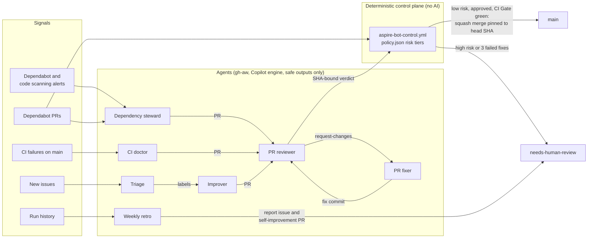

# Aspire Bot

Aspire Bot keeps `microsoft/aspire-samples` healthy on its own. It triages issues, turns
Dependabot and code scanning alerts into fixes, diagnoses CI failures, reviews and fixes its own
pull requests, merges low-risk changes, and runs a weekly retrospective to improve itself.

Humans stay in control through layered kill switches. Each one stops the bot on its own.

## Kill switches

| Switch | Who can use it | What it stops |
|---|---|---|
| `aspire-bot:stop` label on any open issue or pull request | Anyone with triage access | **Everything.** Every agent skips before it starts, and the control plane merges nothing. It stays on until someone removes the label. |
| `ASPIRE_BOT_MODE` repository variable | Anyone with write access | **Everything** when `stopped` or unset. `paused` lets agents analyze but only previews their writes, and nothing merges. |
| `ASPIRE_BOT_MERGE` repository variable | Anyone with write access | **Merges.** Unless it's `enabled`, the control plane merges nothing, even in `active` mode. |
| Circuit breaker | Automatic | **Everything.** The control plane adds `aspire-bot:stop` to the status issue when CI fails on `main` after an Aspire Bot merge, or when 50 automated pull requests merge in 24 hours (well above the busiest day so far). |
| **Disable workflow** on the Actions tab | Anyone with write access | **One agent.** |
| `aspire-bot:hold` label | Anyone with triage access | **One issue or pull request.** `needs-human-review` also blocks merging until a maintainer removes it. |
| Suspend the App, or delete its private key from the `aspire-bot` environment | App owner or repository admin | **Everything that acts as Aspire Bot.** No workflow can get a token. |

Set the variables under **Settings → Secrets and variables → Actions → Variables**.

| `ASPIRE_BOT_MODE` | What happens |
|---|---|
| `active` | The full loop runs. Agents open, review, and fix pull requests. The control plane merges eligible low-risk pull requests when `ASPIRE_BOT_MERGE` is `enabled`. |
| `paused` | Monitoring only. Agents still run and analyze, but pull request, push, review, and comment outputs are **staged**: previewed in the run summary, never written. Triage labels, CI-failure issues, the weekly retro issue, and the status issue still update. Nothing is merged. |
| `stopped` | Every agent workflow skips before activation; only a few-second pre-check runs. The control plane merges nothing and only disarms auto-merge on bot and Dependabot pull requests. |
| unset or anything else | Treated as `stopped`. |

The switches take effect quickly:

- Agents check the stop label and the mode when each run starts. Staged outputs re-read the mode
  when they execute, so leaving `active` also blocks writes from runs already in flight.
- The control plane merges in a separate job. GitHub reads repository variables when each job
  starts, so that job sees mode and merge switch changes made while the rest of the run was going.
  It then checks the stop label and re-reads each pull request immediately before merging it.
- No GitHub auto-merge is ever left enabled on bot or Dependabot pull requests.

## How it works

### Separation of powers

- **Agents can't merge.** They write only through gh-aw safe outputs, which are restricted by
  file allowlists and labels and run under the Aspire Bot GitHub App. They can't add
  `auto-merge` or approve anything.
- **The control plane** (`scripts/aspire_bot.py`, run by `aspire-bot-control.yml`) is the only
  automation that merges bot or Dependabot pull requests. It's deterministic, unit tested, and
  always runs from the default branch (`pull_request_target`, `schedule`, and `workflow_run`), so a
  pull request can't change its own gate.
- **The App credentials stay on `main`.** They're secrets of the `aspire-bot` environment, which
  only the default branch can use. A workflow started from any other branch, including a manual
  run of a modified agent, can't reach them.
- **The merge is atomic.** The merge job calls the merge API with `sha` set to the head commit
  that was classified, approved, and passed **CI Gate**. If anyone pushes in between, GitHub
  refuses the merge, and the new commit needs a new review. It never enables GitHub auto-merge,
  because that would also cover later pushes. The existing `.github/policies/auto-merge.yml`
  label still works for maintainers' own pull requests, and skips Aspire Bot and Dependabot ones.
- **Aspire Bot merges as a ruleset bypass actor.** The `main` ruleset requires one approval, and
  Aspire Bot can't approve its own pull requests, so the App is on that ruleset's bypass list for
  pull requests only. Branch protection still requires **CI Gate**.

### Merge rules

An Aspire Bot or Dependabot pull request is merged only when all of these are true:

1. No open issue or pull request has `aspire-bot:stop`.
2. The mode is `active`, and `ASPIRE_BOT_MERGE` is `enabled`.
3. The latest CI run on `main` didn't fail, and fewer than 50 automated pull requests merged in
   the last 24 hours.
4. The pull request isn't a draft, and it targets the default branch.
5. It has no `aspire-bot:hold` or `needs-human-review` label.
6. Every changed file is **low risk** under `policy.json` (see below).
7. **Aspire Bot pull requests only:** the reviewer's latest verdict is `approve` and is bound to the
   current head SHA. Any new push requires a new review.
8. **Dependabot pull requests only:** the reviewer has not requested changes on the head commit.
9. **CI Gate** succeeded on the head commit.

The merge job re-reads each pull request immediately before merging it, and skips it if anything
above changed.

A verdict counts only when it's the newest Aspire Bot review on the head commit, its footer is the
last two lines, and neither marker appears anywhere else in the review.

Human-authored pull requests are never merged or relabeled.

### Risk tiers (`policy.json`)

Rules are evaluated in order; the first match wins, and unmatched files are high risk.

- **Always high (human review required):**
  - Aspire Bot itself.
  - Workflows, policies, `dependabot.yml`, `CODEOWNERS`, and `build/**`.
  - Sample source code.
- **Low:**
  - Markdown docs.
  - **Version-only** edits to `*.csproj`, `Directory.*.props`, `global.json`, `package.json`, Go,
    Maven, and Python manifests, and the pinned versions in `ci.yml`. A version-only edit is one where
    every changed line is identical except for a well-formed version number, so swapping a package
    source (for example, a git URL in `package.json`) is high risk. Moving or reordering lines also
    makes an edit more than version-only.
  - npm lockfiles, when every package entry that the change adds or modifies resolves from
    `registry.npmjs.org`. Both the merge base and the head commit are parsed as JSON, so
    formatting can't hide a source.
  - Other lockfiles, unless an added line points at an untrusted source (git, file, or link
    protocols, or a `resolved` URL outside the public registry).

High-risk pull requests get the `needs-human-review` label and a comment explaining why.

## Workflows

| Workflow | Trigger | Writes (in `active` mode) |
|---|---|---|
| `aspire-bot-control.yml` | Every 10 minutes, pull request events, after reviewer, fixer, and CI runs | SHA-pinned squash merges (in a separate merge job), labels, auto-merge disarming, the **Aspire Bot status** issue, and the circuit breaker |
| `aspire-bot-triage.md` | Issue opened or reopened, daily sweep | Type labels, `aspire-bot:ready`, one clarifying comment |
| `aspire-bot-dependency-steward.md` | Weekdays | One pull request for an alert or a failing Dependabot PR |
| `aspire-bot-ci-doctor.md` | CI failure on `main` | One fix pull request or one `aspire-bot:ci-failure` issue |
| `aspire-bot-pr-reviewer.md` | Every 30 minutes | `COMMENT` reviews with a verdict |
| `aspire-bot-pr-fixer.md` | Hourly | Fix commits on `aspire-bot` pull requests, at most 3 attempts per pull request (every run counts) |
| `aspire-bot-improver.md` | Weekdays | One pull request for an approved issue, stale docs, or a test gap |
| `aspire-bot-retro.md` | Weekly | Retro issue, plus one self-improvement pull request (always human-reviewed) |
| `aspire-bot-selftest.yml` | Changes to `.github/aspire-bot/**` | None. Runs the control plane unit tests. |

Guardrails:

- No more than 3 open `aspire-bot` pull requests at a time. The workflows that can open pull
  requests share one queue (`aspire-bot-publish`), so they never publish at the same time.
- The improver only implements issues that a maintainer labeled `aspire-bot:approved`. gh-aw
  integrity filtering enforces this.
- A manual fixer run checks the selected pull request against the same rules as a scheduled run,
  including the attempt limit, before the agent starts.
- Agents remember what they already tried in gh-aw cache memory, so they don't retry the same
  item.

## Setup

Do steps 1 through 3 before you merge Aspire Bot.

1. The **Aspire Bot** GitHub App must be installed on the repository with these permissions:
   - **Read and write:** contents, pull requests, issues, workflows.
   - **Read:** actions, checks, security events, Dependabot alerts.
2. A repository admin creates the `aspire-bot` environment under **Settings → Environments**:
   - **Deployment branches and tags:** selected branches only, with `main`.
   - **Environment secrets:** `ASPIRE_BOT_APP_ID` (the App ID) and `ASPIRE_BOT_PRIVATE_KEY`.

   Then delete the repository secrets with the same names, so a workflow on another branch can't
   read them. If a workflow uses the environment before it exists, GitHub creates it with no branch
   restriction.
3. A repository admin adds the Aspire Bot App to the bypass list of the `main` ruleset, with
   **For pull requests only**. The ruleset requires one approval, and Aspire Bot leaves only
   `COMMENT` reviews and can't approve its own pull requests, so without the bypass GitHub
   refuses every merge. Branch protection still requires **CI Gate**.
4. Make sure the repository can use GitHub Copilot for Actions. The workflows authenticate with
   `copilot-requests: write`, so no personal access token is needed.
5. Roll out in stages:
   1. Merge with `ASPIRE_BOT_MODE` unset. Agents skip, and nothing merges.
   2. Set it to `paused` for a few days. Review the staged previews in the run summaries and the
      status issue.
   3. Set it to `active`. Agents open, review, and fix pull requests, and maintainers merge them.
   4. Set `ASPIRE_BOT_MERGE` to `enabled`. The control plane merges eligible low-risk pull requests.

> [!NOTE]
> Until the mode is `active` and `ASPIRE_BOT_MERGE` is `enabled`, Dependabot pull requests are
> **not** merged automatically. The control plane now merges them: `label-prs.yml` no longer adds
> `auto-merge`, and the control plane disarms GitHub auto-merge that was enabled earlier.

## Runbook

| Situation | Action |
|---|---|
| Something looks wrong | Add `aspire-bot:stop` to any open issue or pull request, such as the status issue. Remove it to resume. |
| The circuit breaker tripped | Read its comment on the status issue and fix the cause. Then remove `aspire-bot:stop`. The same cause won't trip it again. |
| Keep agents working, but stop merges | Unset `ASPIRE_BOT_MERGE`. |
| Stop one agent | Disable its workflow on the Actions tab. |
| Revoke all access | Suspend the App installation, or delete `ASPIRE_BOT_PRIVATE_KEY` from the `aspire-bot` environment. |
| One pull request or issue should be left alone | Add `aspire-bot:hold`. |
| Let the bot work on an issue | Make sure triage added `aspire-bot:ready`, then add `aspire-bot:approved`. |
| A pull request has `needs-human-review` | Review it as usual. Merge it yourself, or close it. The bot won't merge it while the label is there. |
| A merge was refused for a missing approval | Add the App to the bypass list of the `main` ruleset (see Setup). |
| Preview what the control plane would do | Run **Aspire Bot Control Plane** manually with `dry-run` checked. |
| Change prompts or triggers | Edit `.github/workflows/aspire-bot-*.md`, then run `gh aw compile --strict` and commit both the `.md` and `.lock.yml` files. |
| Change risk tiers, limits, or labels | Edit `policy.json` and run `python3 -m unittest discover -s .github/aspire-bot/scripts`. |
