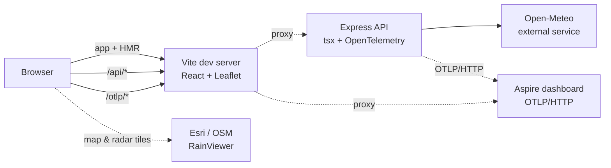
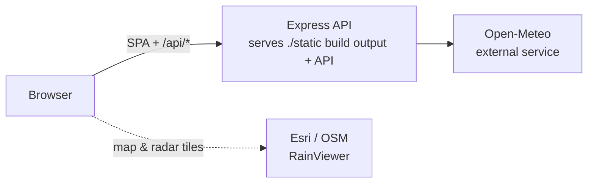

# Node.js fleet weather risk with Aspire

A dispatch board for a freight fleet. It scores each leg of five regional delivery routes for weather risk over the next 6–48 hours and recommends whether to **go**, **delay** or **reroute**. Forecasts come live from the [Open-Meteo](https://open-meteo.com) external service. An Express + OpenTelemetry API does the scoring, and a TypeScript AppHost (`apphost.mts`) orchestrates everything.

The sample consists of two apps:

- **api**: A TypeScript [Express](https://expressjs.com) API run directly with [tsx](https://tsx.is). It splits each route into legs and samples every leg's start, midpoint and end with one multi-coordinate Open-Meteo request. It scores wind gusts, rain, snow, icing, visibility, thunderstorms and extreme cold, then returns a recommendation with leg-by-leg hazards. It also serves an OpenAPI document and an interactive [Scalar](https://scalar.com) API reference. Traces, metrics and [pino](https://getpino.io) logs stream to the Aspire dashboard over OTLP.
- **frontend**: A [React](https://react.dev) 19 + [Vite](https://vite.dev) app with a full-screen [Leaflet](https://leafletjs.com) map. Each route leg is drawn in its risk color. Select a route to re-check it with a fresh forecast and see every leg's hazards, or click the map to plan and assess a custom route. The forecast window is switchable, and the map keeps the animated [RainViewer](https://www.rainviewer.com) radar overlay and switchable basemaps. The browser sends its own OpenTelemetry traces, so a click is traced end to end.

## Architecture

**Run mode:**

**Publish mode:**

## What this demonstrates

- **addExternalService + withHttpHealthCheck**: model the third-party Open-Meteo API as a first-class Aspire resource with a health check surfaced on the dashboard.
- **addNodeApp**: run the TypeScript Express API directly with `tsx`, and preload the OpenTelemetry SDK with `NODE_OPTIONS=--import tsx --import ./src/instrumentation.ts`.
- **withOtlpExporter(OtlpProtocol.HttpProtobuf)**: send the API's and the browser's telemetry to the dashboard over OTLP/HTTP.
- **withHttpHealthCheck / waitFor**: the frontend starts once the API's `/health` endpoint reports healthy.
- **withUrl / withUrlForEndpoint**: label the dashboard links **API**, **API reference (Scalar)**, **OpenAPI JSON** and **Dispatch board**.
- **withHttpCommand**: an **Assess all routes** button on the `api` resource that scores the whole fleet and shows the JSON summary.
- **addViteApp + withReference**: run the React + Vite frontend with hot module replacement, proxying `/api` to the API.
- **publishWithContainerFiles**: bundle the Vite build output into the API container so a single container serves both the SPA and the API in publish mode.

## Prerequisites

- [Aspire development environment](https://aspire.dev/get-started/prerequisites/)
- [Node.js](https://nodejs.org) - version 20.19+, 22.13+, or 24+ (see the `engines` field in `package.json`)

## Running the app

If using the Aspire CLI, run `aspire run` from this directory.

If using VS Code, open this directory as a workspace and start the AppHost with the Aspire extension.

Open **Dispatch board** from the `frontend` resource in the dashboard. The board assesses every route when it loads. Select a route to re-check it and see its legs, change the forecast window, or choose **Plan a custom route** and click the map to drop 2–10 stops.

## API endpoints

The `api` app exposes:

- `GET /api/routes` - the fleet's predefined routes with their waypoints.
- `GET /api/routes/{routeId}/assessment?windowHours=24` - assess one route over a 1–48 hour window.
- `POST /api/routes/assessments?windowHours=24` - assess every route and return a go / delay / reroute summary (the **Assess all routes** command).
- `POST /api/assessments` - assess a custom route through 2–10 waypoints.
- `GET /health` - health probe used by the AppHost.
- `GET /openapi.json` - the OpenAPI 3.1 document.
- `GET /scalar` - the interactive Scalar API reference (`/reference` redirects here).

Errors are [RFC 9457](https://www.rfc-editor.org/rfc/rfc9457) problem details (`application/problem+json`) for `400`, `404` and `502`, and include the request's `traceId`.

Forecasts are cached for 10 minutes per leg and window, so reloading the board or running the dashboard command stays well inside Open-Meteo's free tier (each forecast sample point counts as one call). Selecting a route sends `Cache-Control: no-cache` to re-check it with fresh forecasts. Failed or rate-limited (`429`) Open-Meteo calls are retried twice with backoff.

### How routes are scored

Each leg scores 0–100: its worst hazard over the forecast window, plus 5 for each additional hazard. Hazards start at **moderate** and escalate to **high** and **severe**:

| Hazard | Moderate | High | Severe |
| --- | --- | --- | --- |
| Wind gusts | 50 km/h | 70 km/h | 90 km/h |
| Heavy rain | 4 mm/h | 8 mm/h | 16 mm/h |
| Snowfall | 0.5 cm/h | 1.5 cm/h | 3 cm/h |
| Icing | rain at or below 0.5 °C | freezing drizzle | freezing rain |
| Low visibility | 2,000 m | 500 m | 200 m |
| Thunderstorm | | thunder | thunder with hail |
| Extreme cold | −20 °C | −30 °C | −40 °C |

A route is **rerouted** when any leg has a severe wind, snow or icing hazard, because those close or restrict the corridor. It's **delayed** when its worst leg scores 60 or more for other reasons, such as fog that should lift. Otherwise it's cleared to **go**. Forecasts are live, so the board changes with the weather.

## What to explore in the Aspire dashboard

### Resources and commands

- `open-meteo` is an external service resource with its own health check.
- The `api` resource links to **API**, **API reference (Scalar)** and **OpenAPI JSON**. Run **Assess all routes** from its actions to score the whole fleet. The command result is a JSON summary, for example `{"windowHours":24,"totals":{"go":2,"delay":2,"reroute":1},"routes":[...]}`.
- The `frontend` resource links to the **Dispatch board**.

### Traces

Selecting a route produces one trace, from the click to the weather provider:

- `select route` (browser) → `HTTP GET` (browser fetch, which adds `traceparent`) → `GET /api/routes/:routeId/assessment` (api)
- → `assess route`, with `fleetweather.route.id`, `fleetweather.route.risk_score`, `fleetweather.recommendation` and a `dispatch.decided` event
- → one `assess leg` per leg, with `fleetweather.leg.from`/`to`, `fleetweather.leg.risk_score`, `fleetweather.leg.risk_level`, `fleetweather.leg.max_gust_kph` and `fleetweather.forecast.cached`, a `forecast.received` event, and a `hazard.detected` event per hazard (`hazard.type`, `hazard.severity`, `hazard.peak_value`, `hazard.peak_at`)
- → the outbound Open-Meteo `GET` under each leg, plus a `forecast.retry` event if it had to be retried.

**Assess all** traces as `assess all routes`, which fans out to one request per route. The dashboard command's trace starts at `POST /api/routes/assessments`. Legs served from the forecast cache have no Open-Meteo `GET`. Page loads appear as `documentLoad` traces with resource timings.

### Metrics

The `FleetWeather.Api` meter publishes:

| Instrument | Type | Unit | Attributes |
| --- | --- | --- | --- |
| `fleetweather.route.assessments` | Counter | `{assessment}` | `fleetweather.recommendation`, `fleetweather.route.source` |
| `fleetweather.route.assessments.active` | UpDownCounter | `{assessment}` | `fleetweather.route.source` |
| `fleetweather.leg.risk_score` | Histogram | `{score}` | `fleetweather.risk_level` |
| `fleetweather.hazards.detected` | Counter | `{hazard}` | `fleetweather.hazard.type`, `fleetweather.hazard.severity` |
| `fleetweather.open_meteo.request.duration` | Histogram | `s` | `outcome` |

Metric attributes only use small, fixed sets of values; route and leg details go on spans and logs. The API also reports HTTP server and client metrics and Node.js runtime metrics (event loop, GC and heap).

### Structured logs

The API logs with pino, and the OpenTelemetry pino instrumentation sends each record to the dashboard with its fields as attributes. Entries such as `Route den-gjt assessed: reroute (risk 100)` carry `routeId`, `recommendation`, `overallRiskScore`, `windowHours` and `hazards`. Each high or severe leg logs a warning with `leg`, `legIndex`, `riskScore`, `riskLevel` and `hazards`. Every entry links to its trace.

### API reference

Open **API reference (Scalar)** on the `api` resource. The OpenAPI document (`api/src/openapi.ts`) has tags, summaries, descriptions, typed schemas, realistic examples and problem details responses, and Scalar can send requests to the running API.

## OpenTelemetry setup

- **API**: `api/src/instrumentation.ts` starts the Node.js SDK with OTLP/HTTP (protobuf) exporters for traces, metrics and logs, plus the HTTP, Express, pino and runtime instrumentations. The Open-Meteo client (`api/src/openMeteo.ts`) uses `node:https` rather than `fetch` so that concurrent calls on a cold connection pool still get their own client spans under the right `assess leg`. The AppHost preloads it through `NODE_OPTIONS`, and it registers the `import-in-the-middle` loader hook so that Express and pino can be patched when they're imported from ES modules. OTLP/HTTP is used because the gRPC exporter doesn't trust the dashboard's local development certificate. The domain tracer and meter live in `api/src/telemetry.ts`.
- **Browser**: `frontend/src/telemetry.ts` registers the web tracer with document-load and fetch instrumentation, and `frontend/src/lib/tracing.ts` wraps UI actions in spans. In run mode the Vite resource receives the dashboard's OTLP/HTTP endpoint (`ASPIRE_DASHBOARD_OTLP_HTTP_ENDPOINT_URL` in `aspire.config.json`) and API key. The browser posts spans to the same-origin `/otlp` path, and the Vite dev server forwards them to the dashboard, adding the API key server-side (see `frontend/vite.config.ts`). Because `/api` is also same-origin, the fetch instrumentation adds `traceparent` without CORS. Browser telemetry is run-mode only: production builds don't include the SDK.

## Security notes

This sample keeps the API endpoints public and unauthenticated so it is easy to run and inspect locally. It does not add authentication, authorization, CSRF protection, or rate limiting, so treat it as a demo pattern rather than production-ready API security.

Inputs are validated at the boundary (route ids, the 1–48 hour window, 2–10 waypoints with valid coordinates, and a 16 KB JSON body limit) and every outbound call uses a bounded timeout. The API caches forecasts in memory and retries transient Open-Meteo failures, but a cold **Assess all routes** still makes one Open-Meteo request per leg, and the browser loads map and radar tiles directly from their providers. Production services should add real authN/authZ, request rate limiting, a shared cache, and resilient handling of upstream outages.

For production applications, see the [Node.js security best practices](https://nodejs.org/en/learn/getting-started/security-best-practices), [Express security best practices](https://expressjs.com/en/advanced/best-practice-security.html), and the [OWASP API Security Top 10](https://owasp.org/API-Security/editions/2023/en/0x11-t10/).

## Attributions

This sample relies on several free, community-maintained data sources. If you build on it, please honor their attribution and licensing requirements:

- **Weather data by [Open-Meteo](https://open-meteo.com)** — forecasts are provided by the Open-Meteo API, licensed under [CC BY 4.0](https://creativecommons.org/licenses/by/4.0/).
- **Map data © [OpenStreetMap](https://www.openstreetmap.org/copyright) contributors** — the base map geometry comes from the OpenStreetMap project and is available under the [Open Database License (ODbL)](https://www.openstreetmap.org/copyright).
- Radar imagery by [RainViewer](https://www.rainviewer.com).
- Basemap tiles rendered by [Esri](https://www.esri.com) and [OpenStreetMap](https://www.openstreetmap.org).
