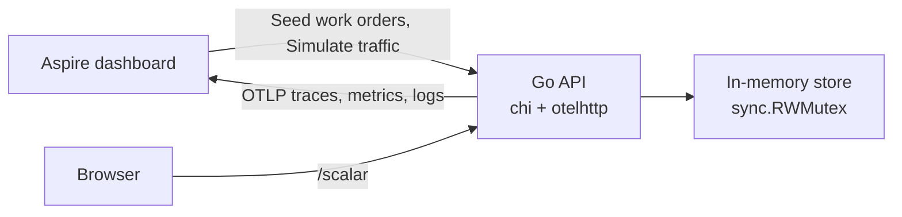

# Go Field-Service Work Order API

REST API for a commercial field-service contractor, written in Go with the chi router and a thread-safe in-memory store. Dispatchers open **work orders** for customer issues, such as a walk-in freezer alarm at a restaurant or a quarterly boiler inspection, assign technicians, and track each job from `open` through `in_progress` to `completed`. The API is instrumented end to end with OpenTelemetry (traces, metrics, and structured logs) and documents itself with an OpenAPI 3.1 document and a themed [Scalar](https://github.com/scalar/scalar) API reference.

This sample demonstrates a **Go AppHost** that runs the Go API directly during local development, adds API reference links and dashboard commands to it, and publishes it to Docker Compose using the Dockerfile that is checked in next to the API.

## Architecture



## What This Demonstrates

- **AddGoApp**: Runs the Go API with `go run .` during local development
- **WithModTidy**: Runs `go mod tidy` before the API starts so `go.mod` and `go.sum` stay current
- **WithUrl**: Adds **API reference (Scalar)** and **OpenAPI JSON** links next to the API's endpoint in the dashboard
- **WithHttpCommand**: Adds **Simulate traffic** and **Seed work orders** commands to the dashboard, in run mode only
- **Publish with a Dockerfile**: Builds the production container image from `api/Dockerfile`
- **AddDockerComposeEnvironment**: Publishes and deploys the API to Docker Compose
- **ConfigureDashboard**: Pins the dashboard published next to the API to host port 9003
- **WithHttpEndpoint**: HTTP endpoint with PORT environment variable
- **WithHttpHealthCheck**: Health check endpoint at `/health`
- **OpenTelemetry for Go**: `otelhttp` server and client spans, `work_order.*` domain spans with lifecycle events, a `FieldService.WorkOrders` meter, Go runtime metrics, and `log/slog` logs exported through `otelslog`
- **Problem details**: RFC 9457 errors with per-field validation messages and the request's `traceId`
- **Scalar API Reference**: A themed, interactive OpenAPI 3.1 reference served straight from the Go binary

## Prerequisites

- [Aspire CLI](../../README.md#aspire-version) 17.0 or later, which the Go AppHost requires.
- [Go](https://go.dev/dl/) 1.26 or later, which the Go AppHost and the OpenTelemetry Go SDK require.
- A container runtime such as Docker, to deploy to Docker Compose.

## Running

```bash
aspire run
```

In the dashboard, select **Simulate traffic** on the **api** resource a few times to fill the traces, metrics, and structured logs pages.

## Commands

```bash
aspire run      # Run locally
aspire resource api simulate-traffic  # Run the Simulate traffic command from another terminal
aspire deploy   # Deploy to Docker Compose
aspire do docker-compose-down-env  # Teardown deployment
```

## Key Aspire Patterns

**Go Application** - Run with `go` locally, publish with a Dockerfile:
```go
builder.AddDockerComposeEnvironment("env").
    ConfigureDashboard(func(dashboard aspire.DockerComposeAspireDashboardResource) {
        dashboard.WithHostPort(&aspire.WithHostPortOptions{Port: aspire.IntPtr(9003)})
    })

api := builder.AddGoApp("api", "./api").
    WithModTidy().
    WithHttpEndpoint(&aspire.WithHttpEndpointOptions{Env: aspire.StringPtr("PORT")}).
    WithHttpHealthCheck(&aspire.WithHttpHealthCheckOptions{Path: aspire.StringPtr("/health")}).
    WithExternalHttpEndpoints()
```

`AddGoApp` runs `go run .` in `./api` when you run the AppHost. When you publish, it builds the image from `api/Dockerfile` because that file exists, and generates a Dockerfile only when there is none. `ConfigureDashboard` publishes the Aspire dashboard on host port `9003`, so its URL stays the same across deployments.

**Dashboard links and commands** - Point the dashboard at the API reference, and add domain actions in run mode only:
```go
endpoint := api.GetEndpoint("http")
api.WithUrl(aspire.RefExpr("%v/scalar", endpoint), aspire.UrlDisplayText("API reference (Scalar)")).
    WithUrl(aspire.RefExpr("%v/openapi.json", endpoint), aspire.UrlDisplayText("OpenAPI JSON"))

if isRunMode {
    api.WithEnvironment("WORKORDERS_ADMIN_ENABLED", "true").
        WithHttpCommand("/admin/simulate", "Simulate traffic", aspire.HttpCommandOptions(&aspire.HttpCommandExportOptions{
            CommandName:   aspire.StringPtr("simulate-traffic"),
            IconName:      aspire.StringPtr("PlayCircle"),
            IsHighlighted: true,
            MethodName:    aspire.StringPtr("POST"),
            ResultMode:    aspire.HttpCommandResultModeJson,
        }))
}
```

The `/admin/seed` and `/admin/simulate` routes exist only when `WORKORDERS_ADMIN_ENABLED` is `true`, so published deployments don't expose them. **Seed work orders** asks for confirmation before it replaces the backlog.

**OpenTelemetry** - `api/telemetry.go` sets up the OpenTelemetry Go SDK from the variables Aspire injects, so no endpoint or key is hard-coded. Each domain operation in `api/service.go` records a span, metrics, and a log entry that carries the span's trace context:
```go
ctx, span := s.tracer.Start(ctx, "work_order.update", trace.WithAttributes(attribute.Int("work_order.id", id)))
defer span.End()
// ...
span.AddEvent("work_order.status_changed", trace.WithAttributes(
    attribute.String("work_order.status.from", string(before.Status)), attribute.String("work_order.status.to", string(after.Status))))
s.resolution.Record(ctx, hours, priorityAttr(after.Priority))
s.log.InfoContext(ctx, "Work order completed", "work_order.id", id, "work_order.resolution_hours", hours)
```

**Environment Variables** - Aspire injects `PORT` for HTTP endpoint configuration, plus `OTEL_EXPORTER_OTLP_ENDPOINT`, `OTEL_EXPORTER_OTLP_HEADERS`, `OTEL_EXPORTER_OTLP_PROTOCOL`, `OTEL_SERVICE_NAME`, and `OTEL_RESOURCE_ATTRIBUTES`, which the OpenTelemetry Go exporters read. Without an OTLP endpoint, the API only logs to stdout.

## What to explore in the Aspire dashboard

### Resources and commands

The **api** resource links to **API reference (Scalar)** and **OpenAPI JSON**. Its actions menu has **Simulate traffic**, which is also pinned as a button on the row, and **Seed work orders**, which resets the store to a 12-job backlog. Simulate traffic calls the API over HTTP like a dispatch console: it opens jobs, starts and completes them, browses queues, and sends a few requests that fail validation, look up a missing work order, or try to reopen a closed one.


### Traces

Open a `POST /admin/simulate` trace. The `work_orders.simulate` span fans out into client spans, server spans such as `PATCH /work-orders/{id}` (named after the chi route, with `http.route`), and domain spans such as `work_order.update`. Domain spans carry `work_order.id`, `work_order.priority`, `work_order.status`, `work_order.assignee`, and `work_order.overdue`, and completed jobs add `work_order.resolution_hours`. Events such as `work_order.created`, `work_order.assigned`, `work_order.status_changed`, and `work_order.rejected` mark each lifecycle step, and rejected requests show up as error spans.


### Metrics

Select the `FieldService.WorkOrders` meter on the **api** resource:

| Instrument | Type | Unit | Attributes |
| --- | --- | --- | --- |
| `workorders.created` | Counter | `{work_order}` | `work_order.priority` |
| `workorders.status_transitions` | Counter | `{transition}` | `work_order.status.from`, `work_order.status.to` |
| `workorders.rejected` | Counter | `{request}` | `reason` (`validation`, `not_found`, `closed`, `capacity`) |
| `workorders.resolution.duration` | Histogram | `h` | `work_order.priority` (measured from `reportedAt` to completion) |
| `workorders.active` | Up-down counter | `{work_order}` | `work_order.priority` |

Histogram points include exemplars that link to the trace that recorded them. The `otelhttp` meter adds `http.server.request.duration` and `http.client.request.duration`, and the runtime instrumentation adds `go.memory.used`, `go.goroutine.count`, and other Go runtime metrics.


### Structured logs

Logs from the `FieldService.WorkOrders` category, such as `Work order opened`, `Work order completed`, and `Work order update rejected`, have `work_order.id`, `work_order.priority`, `work_order.assignee`, `work_order.resolution_hours`, and `reason` fields. Every entry written during a request links to its trace and span.


### API reference

Open **API reference (Scalar)** to browse the operations, grouped into **Work orders**, **Operations**, and **Service**, with request examples, typed schemas, and problem details responses. Select **Test Request** to call the running API. See [API Reference](#api-reference).

## API Endpoints

- `GET /` - Themed Scalar API reference in a browser, or JSON service information for non-browser clients (chosen via `Accept`-header content negotiation)
- `GET /scalar` - Themed Scalar API reference (always HTML). `GET /reference` redirects here.
- `GET /openapi.json` - OpenAPI 3.1 document describing the API
- `GET /health` - Health check
- `GET /work-orders` - List work orders as a dispatch queue (urgent first), optionally filtered by `status`, `priority`, and `assignee`
- `GET /work-orders/{id}` - Get a work order by ID
- `POST /work-orders` - Open a work order. An optional `reportedAt` timestamp records when the customer reported the issue, for example an after-hours call; resolution time is measured from it.
- `PATCH /work-orders/{id}` - Assign, start, complete, cancel, or otherwise update a work order
- `DELETE /work-orders/{id}` - Delete a work order
- `POST /admin/seed` - Reset to the sample backlog (local runs only)
- `POST /admin/simulate?steps=12` - Simulate dispatcher traffic (local runs only)

Errors are `application/problem+json` responses: `400` with per-field `errors` for invalid input and unknown JSON fields, `404` for a missing work order, `409` when a work order is closed or the backlog is full, `413` for bodies over 1 MiB, and `500` for unexpected errors. Each one includes the request's `traceId`:

```json
{
  "type": "https://tools.ietf.org/html/rfc9110#section-15.5.1",
  "title": "One or more validation errors occurred.",
  "status": 400,
  "detail": "Fix the fields listed in errors and try again.",
  "instance": "/work-orders",
  "errors": {
    "priority": ["The priority must be one of low, normal, high, or urgent."],
    "title": ["A title is required."]
  },
  "traceId": "5b8aa5a2d2c872e8321cf37308d69df2"
}
```

## API Reference

The Go binary embeds an OpenAPI 3.1 document (`api/openapi.json`) and a custom-themed Scalar reference page (`api/reference.html`) using `//go:embed`, so no extra services or build steps are required. The document has tags, operation summaries and descriptions, typed request and response schemas, request examples, and problem details responses. The reference uses a distinct Go visual identity&mdash;Gopher cyan (`#00ADD8`) accents on a deep slate canvas, with a matching light theme&mdash;and lets you call the live API straight from the page with the **Test Request** button.

Because `GET /` historically returned JSON, the root is content negotiated: browsers (which send `Accept: text/html`) land on the reference, while curl, fetch, and SDK clients receive JSON. The reference is also always available at `/scalar`.


## Security Notes

This sample keeps the API intentionally small for demo purposes:

- It does not implement authentication or authorization.
- Data is stored only in memory and is lost when the process restarts.
- The seed and simulate routes exist only when `WORKORDERS_ADMIN_ENABLED=true`, which the AppHost sets in run mode only.
- The 1 MiB request body limit and the 1,000 work-order limit are illustrative safeguards, not production capacity planning.
- External HTTP endpoints are enabled to make the demo easy to run and inspect.
- Production services should add real authentication, authorization, rate limiting, persistent storage, and monitoring appropriate for their threat model.

Related references:

- [Go `net/http.Server` docs](https://pkg.go.dev/net/http#Server)
- [OpenTelemetry Go](https://opentelemetry.io/docs/languages/go/)
- [RFC 9457: Problem Details for HTTP APIs](https://www.rfc-editor.org/rfc/rfc9457)
- [Dockerfile best practices: user](https://docs.docker.com/build/building/best-practices/#user)
- [OWASP API Security Top 10](https://owasp.org/API-Security/editions/2023/en/0x11-t10/)
