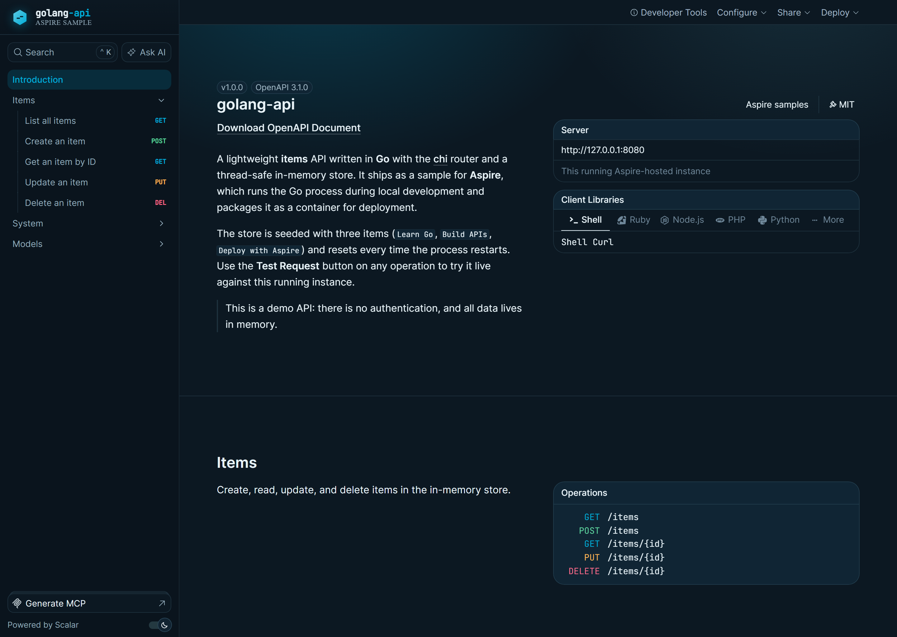
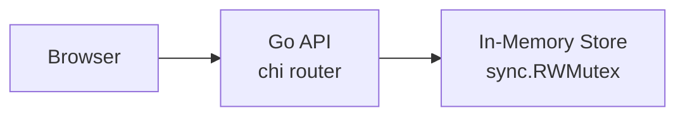

# Go API with In-Memory Storage



REST API built with Go and chi router, using in-memory storage with thread-safe operations. Opening the running app in a browser lands on a themed [Scalar](https://github.com/scalar/scalar) API reference&mdash;a polished, Go-cyan developer portal generated from the service's OpenAPI 3.1 document&mdash;while API clients keep receiving JSON.

This sample demonstrates a **Go AppHost** that runs the Go API directly during local development and publishes it to Docker Compose using the Dockerfile that is checked in next to the API.

## Architecture



## What This Demonstrates

- **AddGoApp**: Runs the Go API with `go run .` during local development
- **WithModTidy**: Runs `go mod tidy` before the API starts so `go.mod` and `go.sum` stay current
- **Publish with a Dockerfile**: Builds the production container image from `api/Dockerfile`
- **AddDockerComposeEnvironment**: Publishes and deploys the API to Docker Compose
- **WithHttpEndpoint**: HTTP endpoint with PORT environment variable
- **WithHttpHealthCheck**: Health check endpoint at `/health`
- **In-Memory Storage**: Thread-safe CRUD operations with sync.RWMutex
- **Chi Router**: Lightweight, idiomatic HTTP router for Go
- **Scalar API Reference**: A themed, interactive OpenAPI 3.1 reference served straight from the Go binary

## Prerequisites

- [Aspire CLI](../../README.md#aspire-version) 17.0 or later. The 13.6.0 CLI that the other samples use is too old for Go AppHosts.
- [Go](https://go.dev/dl/) 1.26 or later, which the Go AppHost requires.
- A container runtime such as Docker, to deploy to Docker Compose.

## Running

```bash
aspire run
```

## Commands

```bash
aspire run      # Run locally
aspire deploy   # Deploy to Docker Compose
aspire do docker-compose-down-env  # Teardown deployment
```

## Key Aspire Patterns

**Go Application** - Run with `go` locally, publish with a Dockerfile:
```go
env := builder.AddDockerComposeEnvironment("env")

api := builder.AddGoApp("api", "./api").
    WithModTidy().
    WithHttpEndpoint(&aspire.WithHttpEndpointOptions{Env: aspire.StringPtr("PORT")}).
    WithHttpHealthCheck(&aspire.WithHttpHealthCheckOptions{Path: aspire.StringPtr("/health")}).
    WithExternalHttpEndpoints()
```

`AddGoApp` runs `go run .` in `./api` when you run the AppHost. When you publish, it builds the image from `api/Dockerfile` because that file exists, and generates a Dockerfile only when there is none.

**Environment Variables** - Aspire injects `PORT` for HTTP endpoint configuration

## API Endpoints

- `GET /` - Themed Scalar API reference in a browser, or JSON service information for non-browser clients (chosen via `Accept`-header content negotiation, so existing JSON consumers are unaffected)
- `GET /reference` - Themed Scalar API reference (always HTML)
- `GET /openapi.json` - OpenAPI 3.1 document describing the API
- `GET /health` - Health check
- `GET /items` - List all items
- `GET /items/{id}` - Get item by ID
- `POST /items` - Create new item
- `PUT /items/{id}` - Update item
- `DELETE /items/{id}` - Delete item

## API Reference

The Go binary embeds an OpenAPI 3.1 document (`api/openapi.json`) and a custom-themed Scalar reference page (`api/reference.html`) using `//go:embed`, so no extra services or build steps are required. The reference uses a distinct Go visual identity&mdash;Gopher cyan (`#00ADD8`) accents on a deep slate canvas&mdash;and lets you call the live API straight from the page with the **Test Request** button.

Because `GET /` historically returned JSON, the root is content negotiated: browsers (which send `Accept: text/html`) land on the reference, while curl, fetch, and SDK clients keep receiving the original JSON payload. The reference is also always available at `/reference`.

## Security Notes

This sample keeps the API intentionally small for demo purposes:

- It does not implement authentication or authorization.
- Data is stored only in memory and is lost when the process restarts.
- The request body, item name, and in-memory item count limits are illustrative safeguards, not production capacity planning.
- External HTTP endpoints are enabled to make the demo easy to run and inspect.
- Production services should add real authentication, authorization, rate limiting, persistent storage, and monitoring appropriate for their threat model.

Related references:

- [Go `net/http.Server` docs](https://pkg.go.dev/net/http#Server)
- [Dockerfile best practices: user](https://docs.docker.com/build/building/best-practices/#user)
- [OWASP API Security Top 10](https://owasp.org/API-Security/editions/2023/en/0x11-t10/)
