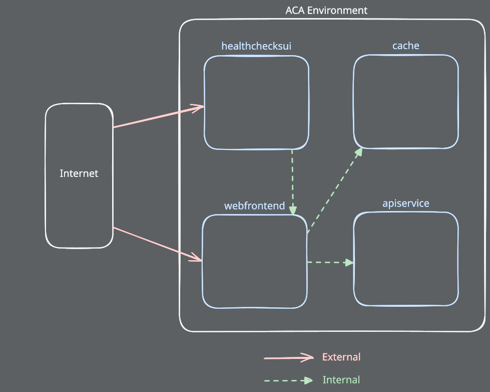

# Configuring health checks & running the ASP.NET Core HealthChecksUI container with Aspire


This sample demonstrates configuring [ASP.NET Core Health Checks](https://learn.microsoft.com/aspnet/core/host-and-deploy/health-checks) and running the [ASP.NET Core HealthChecksUI container](https://github.com/Xabaril/AspNetCore.Diagnostics.HealthChecks/blob/master/doc/ui-docker.md) with Aspire.

The scenario is **Contoso Pay**, a payments gateway. The gateway authorizes card payments with the help of four dependencies, and each one has its own health check:

| Dependency | Health check | When it fails, the check reports | And the gateway |
| --- | --- | --- | --- |
| Card processor (Northwind Card Network) | `card-processor` | **Unhealthy** | Fails payments with a `503` problem |
| Fraud scoring (Woodgrove Risk Engine) | `fraud-scoring` | **Degraded** | Falls back to static fraud rules |
| FX rates (Fabrikam FX) | `fx-rates` | **Degraded** | Settles non-USD payments at the last cached rates |
| Payment store (Redis) | `payment-store` | **Unhealthy** | Fails payments with a `503` problem |

The three third-party dependencies are simulated inside the gateway so you can break them on demand from the Aspire dashboard. The payment store is the real Redis `cache` resource. Slow responses make any check report **Degraded**.

The sample consists of these projects:

- **HealthChecksUI.ApiService**: the payments gateway API. It authorizes payments, keeps recent payments in Redis, and checks its dependencies with ASP.NET Core health checks. A health check publisher runs the checks every 5 seconds, keeps a short history for the status page, logs every status change, and records the results as a metric. The API is documented with OpenAPI and [Scalar](https://scalar.com).
- **HealthChecksUI.Web**: the public status page, a Blazor app that shows each dependency's live status, check history, and recent status changes, plus a page of recent payments that's output-cached in Redis. It supports light and dark themes.
- **HealthChecksUI.AppHost**: the Aspire AppHost. It includes a custom hosting integration for the HealthChecksUI container and the dashboard commands that simulate payment traffic and dependency incidents.
- **HealthChecksUI.ServiceDefaults**: the shared service defaults, including the health checks endpoints and OpenTelemetry registration for every `Contoso.*` meter and activity source.


## Prerequisites

- [Aspire development environment](https://aspire.dev/get-started/prerequisites/)
- [.NET 10 SDK](https://dotnet.microsoft.com/download/dotnet/10.0)

## Running the app

If using the Aspire CLI, run `aspire run` from this directory.

If using VS Code, open this directory as a workspace and launch the `HealthChecksUI.AppHost` project using either the Aspire or C# debuggers.

If using Visual Studio, open the solution file `HealthChecksUI.slnx` and launch/debug the `HealthChecksUI.AppHost` project.

If using the .NET CLI, run `dotnet run` from the `HealthChecksUI.AppHost` directory.

From the Aspire dashboard, click **Status page** on the `webfrontend` resource to open the status page, or **HealthChecksUI Dashboard** on the `healthchecksui` resource to launch the HealthChecksUI.

## What to explore in the Aspire dashboard

### Resource health and commands


- On the **apiservice** resource, run **Simulate payments traffic**. It sends 40 card payments from six merchants through the gateway over about six seconds and returns a JSON summary such as `{"payments":40,"approved":36,"declined":4,"failed":0,"settledUsd":2508.72}`.
- Run **Simulate dependency incident** to break a dependency. The command takes two arguments, the dependency and the issue (an outage or slow responses), so the dashboard prompts for them. From the CLI, pass them as options: `aspire resource apiservice simulate-incident --dependency card-processor --issue outage`.
- Run **Restore dependencies** to end every simulated incident.
- Watch the resource's health. ASP.NET Core returns `200 OK` for both Healthy and Degraded, so `WithHttpHealthCheck` would show a degraded gateway as healthy. The AppHost's `WithHealthReportCheck` reads the status from the `/health` response body instead, so the dashboard shows **Running (Degraded)** when a dependency with a fallback fails and **Running (Unhealthy)** when a critical one does.
- Stop the **cache** resource to take down the real payment store: the `payment-store` check reports Unhealthy and payments fail with a `503` problem until you start it again. The status page reports Unhealthy too, because `AddRedisOutputCache` adds a Redis health check to it automatically (HealthChecksUI lists it as `StackExchange.Redis`).
- Gateway incidents don't affect the status page's health. Its check of the gateway (`payments-api`) only calls the gateway's `/alive` endpoint, and the AppHost uses `WaitForStart` rather than `WaitFor` for it, because a status page has to stay up during the incidents it reports.
- The **API reference (Scalar)** and **OpenAPI JSON** links on **apiservice** open the API documentation. The commands call development-only `/dev/*` endpoints that aren't part of the OpenAPI document.


### HealthChecksUI


The HealthChecksUI container polls each project's detailed `/healthz` endpoint every 10 seconds and shows every check's status, description, and duration, plus a history of each check. HealthChecksUI has no dark theme, so this image is light only.

### API reference


| Method | Route | Description |
| --- | --- | --- |
| `POST` | `/api/payments` | Authorize a card payment. Returns `201` for approved and declined payments, a `400` validation problem for an unknown merchant or an amount outside 0.50–25,000, and a `503` problem when the card processor or the payment store is unavailable |
| `GET` | `/api/payments?limit=20` | The most recent payments, newest first (`limit` from 1 to 50) |
| `GET` | `/api/payments/{paymentId}` | A payment processed in the last 24 hours, or a `404` problem |
| `GET` | `/api/merchants` | The merchants that can take payments |
| `GET` | `/api/status` | The live status of every dependency, its recent check history, and recent status changes. The status page reads it |

`HealthChecksUI.ApiService/HealthChecksUI.ApiService.http` has a request for each case.

### Traces


- **simulated payment**: each simulated payment gets its own trace, linked to the command request that started the simulation.
- **authorize payment**: the gateway's domain span. It carries `contoso.payment.id`, `contoso.merchant.id`, `contoso.payment.amount`, `contoso.payment.currency`, `contoso.payment.card_brand`, `contoso.payment.settlement_amount_usd`, and `contoso.payment.outcome`, and records the `fraud.scored`, `fraud.fallback`, `fx.rate.cached`, `payment.approved`, and `payment.declined` events.
- **fraud-scoring score**, **fx-rates quote**, and **card-processor authorize**: client spans for each dependency call, with `peer.service` set so the dashboard shows the dependency as the destination. A failed call is marked as an error and records the exception. During an FX outage the `fx-rates quote` span fails but the payment is still approved, which is the fallback at work.
- The Redis `SETEX`, `LPUSH`, and `LTRIM` commands that record the payment.
- **GET /api/status**: the status page's refresh, which crosses from `webfrontend` to `apiservice`.
- Health check requests aren't traced. ServiceDefaults filters out `/health`, `/alive`, and the `/healthz` endpoint that HealthChecksUI polls, and uses a parent-based sampler so the Redis `PING` commands behind those checks are dropped too.

### Metrics


| Meter | Instrument | Description |
| --- | --- | --- |
| `Contoso.Payments` | `contoso.payments.authorizations` | Authorization attempts, by outcome (`approved`, `declined`, `failed`), card brand, and currency |
| `Contoso.Payments` | `contoso.payments.authorization.duration` | Histogram of authorization time, in seconds, by outcome |
| `Contoso.Payments` | `contoso.payments.settled.amount` | Histogram of approved payment values, in USD |
| `Contoso.Payments` | `contoso.payments.in_flight` | Up-down counter of payments being authorized |
| `Contoso.Payments` | `contoso.payments.dependency.duration` | Histogram of dependency call time, in seconds, by dependency and outcome |
| `Contoso.Payments` | `contoso.payments.dependency.health` | Observable gauge of each dependency's latest health check result (2 = healthy, 1 = degraded, 0 = unhealthy) |
| `Contoso.StatusPage` | `contoso.statuspage.views` | Status page views, by the overall status shown. Status page traffic usually spikes during incidents |
| `Contoso.StatusPage` | `contoso.statuspage.status_unavailable` | Times the status page couldn't reach the gateway |

Metric tags are limited to bounded values such as the outcome, card brand, currency, and dependency name. Payment and merchant IDs only appear on spans and logs. The histograms record inside spans, so their exemplars link to the trace behind each point. To chart one dependency's health, filter `contoso.payments.dependency.health` by `contoso.dependency.name`.

### Structured logs


Each project logs its key events with source-generated `[LoggerMessage]` methods (`Log.cs`):

- `DependencyHealthChanged` logs each status change once, at Information when a dependency recovers, Warning when it degrades, and Error when it becomes unhealthy, with `Dependency`, `PreviousStatus`, `HealthStatus`, and `HealthDescription` properties. Search for "changed from" to see an incident's timeline.
- `PaymentApproved`, `PaymentDeclined`, `PaymentFailed`, and `FallbackUsed` carry `PaymentId`, `MerchantId`, `Amount`, `Currency`, `DeclineReason`, and `Dependency`, and link to the payment's trace.
- `IncidentSimulated`, `DependenciesRestored`, and `TrafficSimulated` record what the dashboard commands did.

ASP.NET Core also logs a warning or error each time a check that isn't healthy runs. Those come from the `Microsoft.Extensions.Diagnostics.HealthChecks` category.
## Details about the health checks endpoint configuration

Aspire Service Defaults projects configure [health checks and add health checks endpoints by default](https://aspire.dev/fundamentals/health-checks/). However, the endpoints are not exposed in [non-development environments](https://aspire.dev/fundamentals/health-checks/#non-development-environments) by default as doing so has security implications. This sample demonstrates how the default health checks endpoints can be customized to ensure they timeout if execution takes longer than expected, and that the results are cached so that repeated requests do not cause excessive load on the system.

The `AddDefaultHealthChecks` method in the `HealthChecksUI.ServiceDefaults` project adds and configures the [Output Caching](https://learn.microsoft.com/aspnet/core/performance/caching/output) and [Request Timeouts](https://learn.microsoft.com/aspnet/core/performance/timeouts) features of ASP.NET Core via named policies that are then applied to the health checks endpoints in the `MapDefaultEndpoints` method:

```csharp
public static IHostApplicationBuilder AddDefaultHealthChecks(this IHostApplicationBuilder builder)
{
    var healthChecksConfiguration = builder.Configuration.GetSection("HealthChecks");

    // All health checks endpoints must return within the configured timeout value (defaults to 5 seconds)
    var healthChecksRequestTimeout = healthChecksConfiguration.GetValue<TimeSpan?>("RequestTimeout") ?? TimeSpan.FromSeconds(5);
    builder.Services.AddRequestTimeouts(timeouts => timeouts.AddPolicy("HealthChecks", healthChecksRequestTimeout));

    // Cache health checks responses for the configured duration (defaults to 10 seconds)
    var healthChecksExpireAfter = healthChecksConfiguration.GetValue<TimeSpan?>("ExpireAfter") ?? TimeSpan.FromSeconds(10);
    builder.Services.AddOutputCache(caching => caching.AddPolicy("HealthChecks", policy => policy.Expire(healthChecksExpireAfter)));

    builder.Services.AddHealthChecks()
        // Add a default liveness check to ensure app is responsive
        .AddCheck("self", () => HealthCheckResult.Healthy(), ["live"]);

    return builder;
}
```

In addition to the default health checks endpoints at `/health` and `/alive`, this sample configures an additional health checks endpoint that returns more detailed information regarding the individual configured health checks (rather than just a "Healthy" or "Unhealthy" status). This endpoint is consumed by the HealthChecksUI container to display a more detailed view of the health of the application. Because it contains more detailed information, it is configured to only be available when requested via a dedicated additional address that the application listens on, i.e. if the app serves regular HTTP traffic via `http://localhost:5000`, the detailed health checks endpoint will only be available via `http://localhost:5001/` (note the different port). Separating the detailed health checks endpoint onto a different port allows for it to be routed differently and, for example, only exposed to internal services. The app uses the [`RequireHost`](https://learn.microsoft.com/aspnet/core/host-and-deploy/health-checks#require-host) method to ensure the detailed health checks endpoint is only served to requests coming via the additional address:

```csharp
// Add the health checks endpoint for the HealthChecksUI
var healthChecksUrls = app.Configuration["HEALTHCHECKSUI_URLS"];
if (!string.IsNullOrWhiteSpace(healthChecksUrls))
{
    var pathToHostsMap = GetPathToHostsMap(healthChecksUrls);

    foreach (var path in pathToHostsMap.Keys)
    {
        // Ensure that the HealthChecksUI endpoint is only accessible from configured hosts, e.g. localhost:12345, hub.docker.internal, etc.
        // as it contains more detailed information about the health of the app including the types of dependencies it has.

        healthChecks.MapHealthChecks(path, new() { ResponseWriter = UIResponseWriter.WriteHealthCheckUIResponse })
            // This ensures that the HealthChecksUI endpoint is only accessible from the configured health checks URLs.
            // See this documentation to learn more about restricting access to health checks endpoints via routing:
            // https://learn.microsoft.com/aspnet/core/host-and-deploy/health-checks?view=aspnetcore-8.0#use-health-checks-routing
            .RequireHost(pathToHostsMap[path]);
    }
}
```

Here's how the gateway (`apiservice`) exposes its health:

| Endpoint | Checks | Used by |
| --- | --- | --- |
| `/alive` | `self` (tagged `live`) | The AppHost's liveness probe and the status page's `payments-api` check |
| `/health` | All checks; the body is `Healthy`, `Degraded`, or `Unhealthy` and the status code is `503` only when Unhealthy | The AppHost's `WithHealthReportCheck`, which shows the status on the resource in the dashboard |
| `/healthz` | All checks, as HealthChecksUI JSON with each check's description, duration, and data | HealthChecksUI, on the dedicated health checks port only |
| `/api/status` | The dependency checks, run every 5 seconds by an `IHealthCheckPublisher` (`GatewayStatusMonitor`) that keeps the last 30 results and recent status changes | The status page. It's a public API, so it contains no exception details |

The dependency checks are registered with a `failureStatus` that matches the dependency's role: `card-processor` and `payment-store` use `HealthStatus.Unhealthy` because payments can't complete without them, while `fraud-scoring` and `fx-rates` use `HealthStatus.Degraded` because the gateway has a fallback for each (see `HealthChecks.cs`).
When [deployed to Azure Container Apps (ACA) using the Aspire CLI](https://aspire.dev/integrations/cloud/azure/overview/#publish-as-azure-container-app), the additional endpoint will be automatically configured to be only accessible from the internal network of the ACA environment (as an [additional ingress TCP port](https://learn.microsoft.com/azure/container-apps/ingress-overview#additional-tcp-ports)), while the main HTTP endpoint will be configured for [external access](https://learn.microsoft.com/azure/container-apps/ingress-overview#external-and-internal-ingress) via the ACA app ingress rules. This ensures that the detailed health checks endpoint isn't exposed to the public internet, while the main HTTP(S) endpoint is (due to the call to `WithExternalHttpEndpoints()` on the app's resource in the app host project).

The diagram below illustrates the deployment of the sample app to Azure Container Apps with the HealthChecksUI container. You can see that there are **two** arrows pointing in to the `webfrontend` container, indicating the two separate ingress endpoints it's configured with, the main external HTTP(S) endpoint, and the additional internal TCP endpoint that the `healthchecksui` container is using to access the `/healthz` endpoint:



Note that the HealthChecksUI dashboard is configured for external access in this sample for simplicity's sake, but in a real-world scenario, you likely want to require authentication to access the dashboard, e.g. via a custom reverse-proxy that enforces authentication and authorization rules.

## Details about the hosting extension for the HealthChecksUI container

The HealthChecksUI container is integrated into this sample by way of a custom hosting extension, i.e. some C# that adds new types and extension methods to the core object model exposed by `Aspire.Hosting`. The extension is defined in the `HealthChecksUI.AppHost` project in the `HealthChecksUIResource.cs` and `HealthChecksUIExtensions.cs` files. The extensions demonstrate how existing containers can be integrated into the Aspire hosting model, allowing them to be managed and deployed alongside other resources in the same way as built-in resources like ASP.NET Core projects, Redis instances, database containers, and cloud services.

A key aspect of this sample is that the extensions demonstrate how custom overloads of the `WithReference` method can be used to configure both the source and the target resources of the reference. In this case, calling `WithReference` on a HealthChecksUI resource and passing in a project resource results in both resources being configured to enable the scenario:

- The project resource is configured to expose an additional endpoint to host the detailed health checks endpoint on as well as receiving the path that endpoint should be available at (`/healthz` by default)
- The HealthChecksUI resource is configured to add the project resource's detailed health check endpoint as one to include in the set it monitors for health check status, under an optional display name such as "Payments gateway (apiservice)".

The AppHost also adds `WithHealthReportCheck` (in `HealthReportCheckExtensions.cs`), a resource health check that reads the status an ASP.NET Core health checks endpoint writes to its response body. Registering it with `WithHealthCheck` lets the dashboard show a resource as Degraded, which `WithHttpHealthCheck` can't, because ASP.NET Core returns `200 OK` for both Healthy and Degraded.
