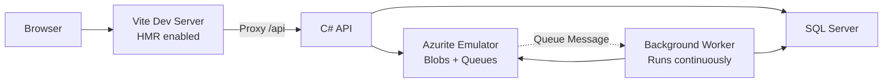
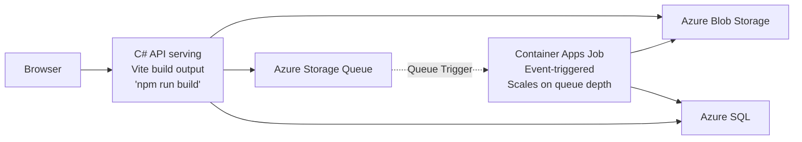

# Image Gallery with Event-Triggered Azure Container Apps Jobs


**Lumina** is the product-photo pipeline behind an e-commerce catalog. Merchandisers upload studio shots for a home & lifestyle store; the API stores each original in Azure Blob Storage, records it in Azure SQL, and queues a request for a queue-triggered worker that renders the 300×300 thumbnails the storefront grid uses. Demonstrates event-driven Container Apps Jobs with queue-based autoscaling, managed identity authentication, and Azure SQL free tier - **can run entirely within Azure free tier limits**.

One upload produces **one distributed trace** across the upload API, the blob write, the SQL insert, the queue message (the W3C trace context travels inside the message), the worker's processing, the thumbnail write, and the SQL update. Domain metrics, source-generated structured logs, a documented OpenAPI reference, and two dashboard commands make the pipeline easy to explore in the Aspire dashboard.

The **Lumina** front end is a catalog photo studio built with React, TypeScript, CSS Modules and [Heroicons](https://heroicons.com/). It ships light and dark themes (honoring `prefers-color-scheme`), a responsive product grid, an accessible drag-and-drop upload flow, live thumbnail polling and a keyboard-operable lightbox.

## Architecture

**Run Mode:**


**Publish Mode:**


## How It Works

### Event-Driven Thumbnail Processing

1. **Upload**: A merchandiser uploads a product photo → the API validates the image bytes, saves the original to Azure Blob Storage and its metadata to Azure SQL
2. **Queue**: The API enqueues a thumbnail request to Azure Storage Queue, carrying the upload's W3C `traceparent` in the message body
3. **Trigger**: Azure monitors queue depth and automatically starts a Container Apps Job instance
4. **Process**: Job processes messages in batches (up to 10), continues the upload's trace, generates thumbnails using SkiaSharp, and marks the photo ready in SQL
5. **Scale Down**: After 2 empty polls (~5 seconds), job exits; new instances start automatically when messages arrive

### Local Development vs Production

**Production (Event-Triggered):**
- Job starts when queue depth > 0, exits within ~5 seconds when empty
- API and worker both scale to zero when idle

**Local Development (Continuous):**
- Worker runs continuously, polls every 5 seconds
- Instant feedback with Azurite emulator and SQL Server container

## What This Demonstrates

- **Event-Driven Jobs**: Container Apps Jobs with queue-based autoscaling rules using Azure.Provisioning APIs
- **Dual-Mode Resources**: Azurite/SQL Server containers locally, Azure services in production (`.RunAsEmulator()`, `.RunAsContainer()`)
- **Free Tier Deployment**: Azure SQL free tier with serverless auto-pause, Container Apps scale-to-zero
- **Managed Identity**: Password-less authentication to all Azure resources (Storage, SQL, Queues)
- **Polyglot Stack**: Vite+React frontend embedded in C# API container, SkiaSharp for image processing
- **OpenTelemetry**: One distributed trace per upload across API → Blob Storage → SQL → queue → worker, W3C context propagated through the queue message, plus `Lumina.*` domain meters and `[LoggerMessage]` structured logs
- **OpenAPI + Scalar**: Typed minimal APIs with summaries, tags, examples, upload size limits and RFC 9457 problem details, browsable in Scalar
- **Dashboard Commands**: "Upload sample photos" and "Reprocess all thumbnails" run the pipeline on demand with `WithHttpCommand`

## Running Locally

```bash
aspire run
```

No Azure resources required - uses Azurite emulator and SQL Server container. Open **Catalog photo studio** from the dashboard, then run **Upload sample photos** on the `api` resource to fill the catalog with eight studio product photos bundled in `api/SamplePhotos`.

## What to explore in the Aspire dashboard

### Resources and commands


- **frontend** links to the **Catalog photo studio**. **api** links to **API reference (Scalar)** and **OpenAPI JSON**. **storage** (Azurite) and **sql** (SQL Server) run as local containers.
- **Upload sample photos** (highlighted on the `api` row) calls the development-only `POST /api/operations/sample-photos`. It runs eight bundled product photos through the same pipeline as a browser upload and returns `{"uploaded":8,"photos":[...]}`.
- **Reprocess all thumbnails** asks for confirmation, then calls `POST /api/operations/reprocess-thumbnails`. It marks every photo as processing, re-queues a thumbnail request for each one, and returns `{"queued":8}`. Run it a few times to populate the worker's metrics.

### Traces


Open the `api: POST /api/images/` trace to follow a single upload end to end:

- **api**: `POST /api/images/` (with `lumina.image.id`, `lumina.photo.format`, `lumina.photo.size`, `lumina.photo.width`/`height` and a `photo.stored` event) → `BlobClient.Upload` → `INSERT` into `imagedb` → `send thumbnails` (producer span with `messaging.system`, `messaging.destination.name`, `messaging.message.id` and `lumina.thumbnail.trigger`) → `QueueClient.SendMessage`.
- **worker**: `process thumbnails` (consumer span parented to the producer through the `traceparent` in the message body, with `lumina.message.dequeue_count`) → blob download → `render thumbnail` (source and thumbnail dimensions plus `image.decoded` and `thumbnail.encoded` events) → `BlobClient.Upload` of the thumbnail → `SELECT`/`UPDATE` in `imagedb` → `QueueClient.DeleteMessage`.
- The dashboard labels the messaging spans `MSG azure_storage_queues thumbnails`. The gap between them is the time the message waited in the queue. Failed attempts set the consumer span's status to error and record the exception.
- The worker polls the queue every few seconds; a custom sampler drops those idle root polling spans so the trace list only shows real work.

### Metrics


| Meter | Instrument | Description |
| --- | --- | --- |
| `Lumina.Api` | `lumina.photos.uploaded` | Photos stored in Blob Storage and SQL, by `lumina.photo.format` and `lumina.upload.source` (`upload` or `sample`) |
| `Lumina.Api` | `lumina.photo.upload.size` | Histogram of accepted upload sizes, in bytes |
| `Lumina.Api` | `lumina.photos.rejected` | Uploads rejected by validation, by `lumina.rejection.reason` (`empty`, `too_large`, `unsupported_type`, `invalid_image`) |
| `Lumina.Api` | `lumina.thumbnails.requested` | Thumbnail requests published to the queue, by `lumina.thumbnail.trigger` (`upload` or `reprocess`) |
| `Lumina.ThumbnailWorker` | `lumina.thumbnails.generated` | Thumbnails generated, by `lumina.photo.format` |
| `Lumina.ThumbnailWorker` | `lumina.thumbnail.duration` | Histogram of the time to download, resize, encode and save a thumbnail and update SQL, in seconds |
| `Lumina.ThumbnailWorker` | `lumina.thumbnails.failed` | Failed thumbnail attempts, by `error.type` |
| `Lumina.ThumbnailWorker` | `lumina.thumbnails.backlog` | Up-down counter of messages waiting in the `thumbnails` queue, as last observed by the worker |

Metric tags are bounded (formats, sources, triggers, reasons and error types). Photo IDs and file names only appear on spans and logs.

### Structured logs

Both services log through source-generated `[LoggerMessage]` methods (`api/Log.cs` and `worker/Log.cs`), so fields such as `ImageId`, `FileName`, `SizeBytes`, `Format`, `MessageId`, `Trigger`, `Reason`, `QueueDepth`, `DequeueCount` and `ElapsedMs` are filterable in **Structured logs**. Each entry links to the trace that produced it: filter on `ImageId` to see the upload, the queued request, and the worker's `Generated ... thumbnail for photo ...` entry side by side.

### API reference (Scalar)


Open **API reference (Scalar)** on the `api` resource (served at `/scalar` in Development; the raw document is at `/openapi/v1.json`). The "Lumina Catalog Photos API" document groups operations into **Photos**, **Security** and **Operations** tags, and every operation has a summary, a description, typed responses and RFC 9457 problem details:

| Method | Route | Description |
| --- | --- | --- |
| `GET` | `/api/images` | List catalog photos, newest first (`skip`, `take` up to 100) |
| `POST` | `/api/images` | Upload a product photo (multipart, max 10 MB); `400` for invalid images, `413` when too large |
| `GET` | `/api/images/{id}` | Get a photo's metadata and thumbnail status |
| `GET` | `/api/images/{id}/blob` | Download the original photo |
| `GET` | `/api/images/{id}/thumbnail` | Download the 300×300 catalog thumbnail (`404` until it's ready) |
| `DELETE` | `/api/images/{id}` | Delete the photo, its thumbnail and its record |
| `GET` | `/api/antiforgery` | Get the antiforgery token required by uploads and deletes |
| `POST` | `/api/operations/sample-photos` | Development only: upload the bundled sample photos |
| `POST` | `/api/operations/reprocess-thumbnails` | Development only: re-queue every thumbnail |

## Deploying to Azure

**Prerequisites for deployment:**
- [Azure CLI](https://learn.microsoft.com/cli/azure/install-azure-cli)
- [Azure subscription](https://azure.microsoft.com/free/)

**Commands:**
```bash
aspire run      # Run locally with Azurite
aspire publish  # Generate Bicep files to explore deployment artifacts (output in ./aspire-output)
aspire deploy   # Deploy to Azure Container Apps
```

## Security Notes

**Implemented:**
- ✅ **Managed Identity**: Password-less authentication to all Azure resources (no connection strings or secrets)
- ✅ **XSRF Protection**: Antiforgery tokens protect upload/delete endpoints from cross-site request forgery attacks ([docs](https://learn.microsoft.com/aspnet/core/security/anti-request-forgery))
- ✅ **Input Validation**: 10 MB file size limit (larger requests get a `413` problem details response), extension allowlist (.jpg, .jpeg, .png, .gif, .webp), and server-side image byte validation before saving or queueing uploads ([file upload security](https://learn.microsoft.com/aspnet/core/mvc/models/file-uploads))
- ✅ **Filename Sanitization**: Path traversal prevention, 255 char limit
- ✅ **Resource Limits**: Pagination (max 100 items), retry limits (3 attempts), size checks (20 MB max)
- ✅ **Development-only Operations**: Scalar, the OpenAPI document, and the dashboard command endpoints under `/api/operations` are only mapped in Development

**Not Implemented (Required for Production):**
- ❌ **Authentication & Authorization**: Endpoints are public - anyone can upload/delete
- ❌ **Rate Limiting**: No protection against abuse or DoS ([docs](https://learn.microsoft.com/aspnet/core/performance/rate-limit))
- ❌ **Malware Scanning**: Image byte validation rejects unsupported or malformed images, but production upload workflows should consider malware scanning and the broader [ASP.NET Core security guidance](https://learn.microsoft.com/aspnet/core/security/)

## Key Aspire Patterns

**Azure Storage Emulation** - Automatic Azurite in run mode, real Azure in publish:
```csharp
var storage = builder.AddAzureStorage("storage").RunAsEmulator();
var blobs = storage.AddBlobContainer("images");
var queues = storage.AddQueues("queues");
```

**Azure SQL Dual Mode** - SQL Server container locally, Azure SQL free tier in production:
```csharp
var sql = builder.AddAzureSqlServer("sql")
    .RunAsContainer()
    .AddDatabase("imagedb");
```

Defaults to Azure SQL free tier with serverless auto-pause (SKU: GP_S_Gen5_2).

**Scale to Zero** - API only runs when handling requests:
```csharp
api.PublishAsAzureContainerApp((infra, app) =>
{
    app.Template.Scale.MinReplicas = 0;
});
```

**Event-Triggered Container App Job** - Direct control over Azure resources with Azure.Provisioning libraries:

This example demonstrates using the **Azure.Provisioning** libraries to directly configure low-level Azure resources (Bicep/ARM) from the AppHost. This provides complete flexibility and control when Aspire's higher-level APIs don't expose specific features.

```csharp
worker.PublishAsAzureContainerAppJob((infra, job) =>
{
    // Direct access to Azure Provisioning APIs - full control over Bicep/ARM templates

    // Get storage account name for queue authentication
    var accountNameParameter = queues.Resource.Parent.NameOutputReference.AsProvisioningParameter(infra);

    // Configure event-driven trigger using Container Apps Job APIs
    job.Configuration.TriggerType = ContainerAppJobTriggerType.Event;
    job.Configuration.EventTriggerConfig.Scale.Rules.Add(new ContainerAppJobScaleRule
    {
        Name = "queue-rule",
        JobScaleRuleType = "azure-queue",
        Metadata = new ObjectExpression(
            // Bicep expressions - referencing other resources dynamically
            new PropertyExpression("accountName", new IdentifierExpression(accountNameParameter.BicepIdentifier)),
            new PropertyExpression("queueName", new StringLiteralExpression("thumbnails")),
            new PropertyExpression("queueLength", new IntLiteralExpression(1)) // Start job when 1+ messages
        ),
        Identity = identityAnnotation.IdentityResource.Id.AsProvisioningParameter(infra) // Use managed identity
    });
});
```

This approach gives you full control over Azure resource configuration without waiting for Aspire abstractions to expose every feature. The C# strongly-typed APIs generate correct Bicep/ARM templates with automatic dependency tracking and parameter passing between resources. You can seamlessly mix high-level Aspire APIs with low-level Azure Provisioning when you need fine-grained control.

**Dual-Mode Worker** - Continuous in run mode, event-triggered in publish mode:
```csharp
// AppHost: Set environment variable only in run mode
if (builder.ExecutionContext.IsRunMode)
{
    worker = worker.WithEnvironment("WORKER_RUN_CONTINUOUSLY", "true");
}

// Worker: Adapt behavior based on mode
if (configuration.GetValue<bool>("WORKER_RUN_CONTINUOUSLY"))
{
    // Local dev: poll every 5 seconds, run forever
    await RunAsync(continuous: true, stoppingToken);
}
else
{
    // Production: poll up to 2 times (5s intervals), exit when empty
    // MaxEmptyPolls = 2, EmptyPollWaitSeconds = 5
    await RunAsync(continuous: false, stoppingToken);
}
```

**Graceful Shutdown** - Event-triggered mode always stops, exceptions crash naturally:
```csharp
if (configuration.GetValue<bool>("WORKER_RUN_CONTINUOUSLY"))
{
    // Continuous mode: run forever, let exceptions crash the app
    await RunAsync(continuous: true, stoppingToken);
}
else
{
    try
    {
        // Event-triggered mode: process messages until queue empty, then shutdown
        await RunAsync(continuous: false, stoppingToken);
    }
    finally
    {
        // Always stop application when done (success or exception)
        // New instances will start automatically when queue has messages
        hostApplicationLifetime.StopApplication();
    }
}
```

**Trace Context Through the Queue** - Azure Storage Queues has no message headers, so the API writes the W3C context into the message body and the worker continues the trace:
```csharp
// API: inject the producer span's context into the thumbnail request
using var activity = GalleryTelemetry.ActivitySource.StartActivity($"send {QueueName}", ActivityKind.Producer);
var carrier = new Dictionary<string, string>();
DistributedContextPropagator.Current.Inject(activity, carrier,
    static (c, key, value) => ((Dictionary<string, string>)c!)[key] = value);
var request = new ThumbnailRequest(image.Id, blobName, carrier.GetValueOrDefault("traceparent"), carrier.GetValueOrDefault("tracestate"));

// Worker: parent the consumer span on the uploader's context
ActivityContext.TryParse(request.TraceParent, request.TraceState, isRemote: true, out var parentContext);
using var activity = ThumbnailTelemetry.ActivitySource.StartActivity($"process {QueueName}", ActivityKind.Consumer, parentContext);
```

**Dashboard Commands** - Run the pipeline from the dashboard with HTTP commands:
```csharp
api.WithHttpCommand("/api/operations/sample-photos", "Upload sample photos", commandName: "upload-sample-photos", commandOptions: new()
{
    IconName = "ImageAdd",
    IsHighlighted = true,
    ResultMode = HttpCommandResultMode.Json
});
```

**Container Files Publishing** - Embed Vite build output in API container:
```csharp
api.PublishWithContainerFiles(frontend, "wwwroot");
```

## Performance & Cost Characteristics

**Response Times:**
- Thumbnail generation: typically ready within seconds of upload
- Local development: instant feedback with continuous polling

**Cost Optimization:**
- **Compute**: API and worker scale to zero when idle (~5 seconds), only pay for active processing
- **SQL**: Free tier with serverless auto-pause (GP_S_Gen5_2), free up to monthly limits
- **Storage**: Pay only for blob storage used, queues/blobs have minimal costs at low volumes
- **Result**: Can run entirely within Azure free tier limits

**Further optimization:** Using SAS URLs instead of API blob streaming would eliminate compute/egress costs for serving images

**Scalability:**
- Parallel job instances spawn automatically for high queue depth
- Batch processing (up to 10 messages per poll)
- Managed identity eliminates secrets management overhead
