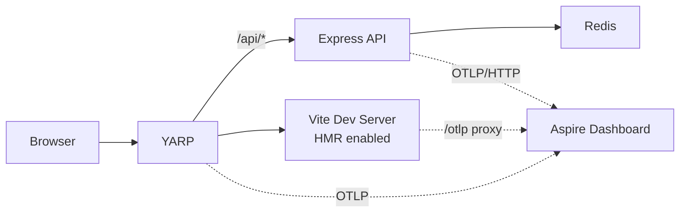
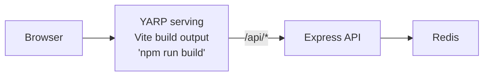

# Node.js Express + Redis + Vite Frontend

A shopping cart service for "Contoso Coffee" with an Express backend, Redis-backed carts and a React TypeScript storefront behind YARP. Each cart is a Redis hash with a 30-minute sliding expiry, so carts that shoppers walk away from clean themselves up. Shoppers browse a small catalog of coffee and brewing gear, add, change and remove items, and check out. Orders over $500 are rejected with a `409` problem details response.

The sample is fully instrumented with OpenTelemetry: browser spans, YARP proxy spans, Express and Redis spans, custom `cart.*` domain spans, `Contoso.Cart` metrics and pino structured logs all land in the Aspire dashboard, correlated by trace id. The API is documented with OpenAPI and Scalar.


## Architecture

**Run Mode:**


**Publish Mode:**


## What This Demonstrates

- **addNodeApp**: Express cart API with Redis integration, OpenTelemetry preloaded via `NODE_OPTIONS`
- **withOtlpExporter(HttpProtobuf)**: Node.js and the browser export telemetry over OTLP/HTTP (the gRPC exporter doesn't trust the dashboard's development certificate in Node.js)
- **withUrl / withUrlForEndpoint / withHttpCommand**: friendly dashboard links (**API**, **API reference (Scalar)**, **OpenAPI JSON**, **Storefront**) and a **Simulate shoppers** button on the API resource
- **addViteApp**: React + TypeScript storefront with Vite and browser telemetry
- **addYarp**: Single endpoint for frontend and API with path transforms
- **addRedis + withRedisInsight**: Redis with automatic connection injection and Redis Insight for browsing the cart keys
- **waitFor + withHttpHealthCheck**: the API waits for Redis, and its `/health` endpoint pings Redis
- **publishWithStaticFiles**: Frontend embedded in YARP for publish mode
- **Dual-Mode Operation**: Vite HMR in run mode, Vite build output in publish mode

## Running

```bash
aspire run
```

The `app` (YARP) resource uses explicit start: start it from the dashboard, then open its **Storefront** link. Add a few products and check out, or choose **Simulate shoppers** on the `api` resource to generate a burst of carts and orders.

## How carts are stored

| Redis key | Type | Holds |
| --- | --- | --- |
| `contoso-coffee:cart:{cartId}` | hash, 30-minute TTL | `createdAt`, the W3C `traceparent` of the request that created the cart, and an `item:{sku}` field (quantity) per line |
| `contoso-coffee:carts:expiry` | sorted set | cart ids scored by expiry time |
| `contoso-coffee:orders:recent` | list, capped at 20 | the latest orders as JSON |

Every read or write renews the cart's TTL (`EXPIRE`) and its score in the expiry index in the same `MULTI` transaction. When a shopper walks away, Redis drops the hash after 30 minutes and the next request for it returns `404 Cart not found`. A background sweep in the API moves expired ids out of the sorted set every few seconds to count abandoned carts and report how many carts are active. Checkout turns the cart into an order in one transaction (`DEL`, `ZREM`, `LPUSH`, `LTRIM`).

## API endpoints

The `api` app exposes (YARP serves these under `/api`):

- `GET /products` - the catalog.
- `POST /carts` - create a cart (`201` with a `Location` header).
- `GET /carts/{cartId}` / `DELETE /carts/{cartId}` - read (and renew) or delete a cart.
- `POST /carts/{cartId}/items` - add units of a product (`{ "sku": "yirgacheffe", "quantity": 2 }`).
- `PUT /carts/{cartId}/items/{sku}` / `DELETE /carts/{cartId}/items/{sku}` - set a line's quantity (0 removes it) or remove the line.
- `POST /carts/{cartId}/checkout` - place the order (`201`), or `409` when the cart is empty or over the $500 limit.
- `GET /orders/recent?limit=5` - the latest orders.
- `POST /simulate/shoppers?shoppers=8` - run-mode only; the **Simulate shoppers** command.
- `GET /health`, `GET /openapi.json` and `GET /scalar`.

Errors are [RFC 9457](https://www.rfc-editor.org/rfc/rfc9457) problem details (`application/problem+json`) for `400`, `404`, `409` and `503`, and include the request's `traceId`.

## What to explore in the Aspire dashboard

### Resources and commands


- The `api` resource links to **API**, **API reference (Scalar)** and **OpenAPI JSON**, and waits for `redis` to be healthy.
- **Simulate shoppers** (run mode) sends 8 concurrent shoppers through the same cart code as the storefront: most fill a cart and check out, one abandons its cart and one goes over the order limit, drops a grinder and checks out on the second try. The result is a JSON summary, for example `{"shoppers":8,"ordersPlaced":7,"abandonedCarts":1,"orderLimitRejections":1,"revenue":1025.25,...}`. Abandoned simulated carts expire after 45 seconds instead of 30 minutes, so the expiry metric moves quickly.
- `redis` links to Redis Insight (**Manage (Insights)**), where you can watch cart hashes and their TTLs.
- The `app` (YARP) resource links to the **Storefront**.

### Traces


One click in the storefront is one trace, from the browser to Redis:

- `checkout` (browser) → `POST` (browser fetch, which adds `traceparent`) → `POST api/{**catch-all}` (YARP) → `POST /carts/:cartId/checkout` (api)
- → `cart.checkout`, with `cart.id`, `cart.line_count`, `cart.item_count`, `cart.subtotal`, `cart.age_seconds` and `order.id`, an `order.placed` event (or `checkout.rejected` with `checkout.reason`), and a **span link** to the trace that created the cart. The cart's `traceparent` is stored in Redis, so the context crosses the cache.
- → one span per Redis command, including each command of the `MULTI` transaction.

**Add** and the quantity buttons trace as `add to cart`, `change quantity` and `remove item` through `cart.add_item`, `cart.update_item` and `cart.remove_item`. The expiry sweep traces as `cart.expire` (with a `cart.expired` event per cart) only when carts actually expired, and **Simulate shoppers** traces as `cart.simulate_shoppers` with one `cart.simulate_shopper` span per shopper. Page loads appear as `documentLoad` traces.

### Metrics


The `Contoso.Cart` meter publishes:

| Instrument | Type | Unit | Attributes |
| --- | --- | --- | --- |
| `cart.items.added` | Counter | `{item}` | `product.category` |
| `cart.items.removed` | Counter | `{item}` | `product.category` |
| `cart.checkouts` | Counter | `{checkout}` | `cart.checkout.outcome` (`completed`, `over_limit`, `empty`) |
| `cart.order.value` | Histogram | `USD` | |
| `cart.carts.active` | Gauge | `{cart}` | |
| `cart.carts.expired` | Counter | `{cart}` | |

Metric attributes only use small, fixed sets of values; cart ids, order ids and SKUs go on spans and logs. The API also reports HTTP server metrics and Node.js runtime metrics (event loop, GC and heap).

### Structured logs


The API logs with [pino](https://getpino.io), and the OpenTelemetry pino instrumentation sends each record to the dashboard with its fields as attributes. Entries such as `Order CC-7QK4MZ placed: 9 items, $309.00` carry `orderId`, `cartId`, `itemCount`, `lineCount`, `subtotal` and `cartAgeSeconds`; `Checkout rejected: $613.25 is over the $500.00 order limit` is a warning with `subtotal` and `orderLimit`; and the sweep logs `1 abandoned cart expired before checkout`. Request entries link to their trace.

### API reference


Open **API reference (Scalar)** on the `api` resource. The hand-written OpenAPI 3.1 document (`api/openapi.js`) has tags, summaries, descriptions, typed schemas, realistic examples and problem details responses, and Scalar can send requests to the running API.

## OpenTelemetry setup

- **API**: `api/instrumentation.js` starts the Node.js SDK with OTLP/HTTP (protobuf) exporters for traces, metrics and logs, plus the HTTP, Express, node-redis, pino and runtime instrumentations. The AppHost preloads it through `NODE_OPTIONS`, and it registers the `import-in-the-middle` loader hook so that Express and pino can be patched when they're imported from ES modules. Redis commands are only traced inside a request or domain span, so the background expiry sweep doesn't flood the trace list. The domain tracer and meter live in `api/telemetry.js`.
- **Browser**: `frontend/src/telemetry.ts` registers the web tracer with document-load and fetch instrumentation, and `frontend/src/lib/tracing.ts` wraps UI actions in spans. In run mode the Vite resource receives the dashboard's OTLP/HTTP endpoint (`ASPIRE_DASHBOARD_OTLP_HTTP_ENDPOINT_URL` in `aspire.config.json`) and API key. The browser posts spans to the same-origin `/otlp` path, which YARP forwards to the Vite dev server, which proxies to the dashboard and adds the API key server-side (see `frontend/vite.config.ts`). Because `/api` is also same-origin, the fetch instrumentation adds `traceparent` without CORS. Browser telemetry is disabled in the published static build.
- **YARP**: in run mode the AppHost sets `YARP_UNSAFE_OLTP_CERT_ACCEPT_ANY_SERVER_CERTIFICATE` on the YARP container, because it doesn't trust the local dashboard's development certificate. Without it, YARP's proxy spans are dropped and the trace goes straight from the browser to the API.

## Security Notes

This sample keeps the Express endpoints public and unauthenticated so the cart is easy to run and inspect locally. Anyone who knows a cart id can read or change that cart. The sample does not add CSRF protection, rate limiting, authentication, or authorization, so treat it as a demo pattern rather than production-ready API security.

Inputs are validated at the boundary: cart ids must be UUIDs, SKUs must exist in the catalog, line quantities are 1-10, recent-order and simulation counts are bounded, and JSON bodies are limited to 10 KB. Redis keys are namespaced under `contoso-coffee:`, every cart key expires, and the recent-orders list is capped, so the key space stays bounded. The `/simulate/shoppers` endpoint only exists when the AppHost sets `ENABLE_SHOPPER_SIMULATION` (run mode).

For production applications, add real authN/authZ (tie carts to a session or user), request rate limiting, CSRF protection where browser credentials are used, and Redis security controls appropriate for your deployment. See the [Node.js security best practices](https://nodejs.org/en/learn/getting-started/security-best-practices), [Express body parser limits documentation](https://expressjs.com/en/resources/middleware/body-parser.html), [Redis security documentation](https://redis.io/docs/latest/operate/oss_and_stack/management/security/), and [OWASP API Security Top 10](https://owasp.org/API-Security/editions/2023/en/0x11-t10/).

## Commands

```bash
aspire run      # Run locally
aspire deploy   # Deploy to Docker Compose
aspire do docker-compose-down-dc  # Teardown deployment
```

## Key Aspire Patterns

**YARP Routing** - Single endpoint with path-based routing:
```ts
const app = await builder.addYarp("app")
    .withConfiguration(async (yarp) =>
    {
        const apiCluster = await yarp.addClusterFromResource(api);
        await (await yarp.addRoute("api/{**catch-all}", apiCluster))
            .withTransformPathRemovePrefix("/api");

        if (isRunMode)
        {
            const frontendCluster = await yarp.addClusterFromResource(frontend);
            await yarp.addRoute("{**catch-all}", frontendCluster);
        }
    })
    .publishWithStaticFiles(frontend);
```

**OpenTelemetry for Node.js** - Preload the SDK and export over OTLP/HTTP:
```ts
const api = await builder.addNodeApp("api", "./api", "index.js")
    .withEnvironment("NODE_OPTIONS", "--import ./instrumentation.js")
    .withOtlpExporter({ protocol: OtlpProtocol.HttpProtobuf })
    .waitFor(redis)
    .withReference(redis);
```

**Dashboard command** - A dev-only button on the API resource:
```ts
await api
    .withEnvironment("ENABLE_SHOPPER_SIMULATION", "true")
    .withHttpCommand("/simulate/shoppers", "Simulate shoppers", {
        methodName: "POST",
        resultMode: HttpCommandResultMode.Json,
    });
```

**Redis Connection** - Automatic connection string injection via the `REDIS_URI` environment variable

**WaitFor** - Ensures Redis starts before the API
