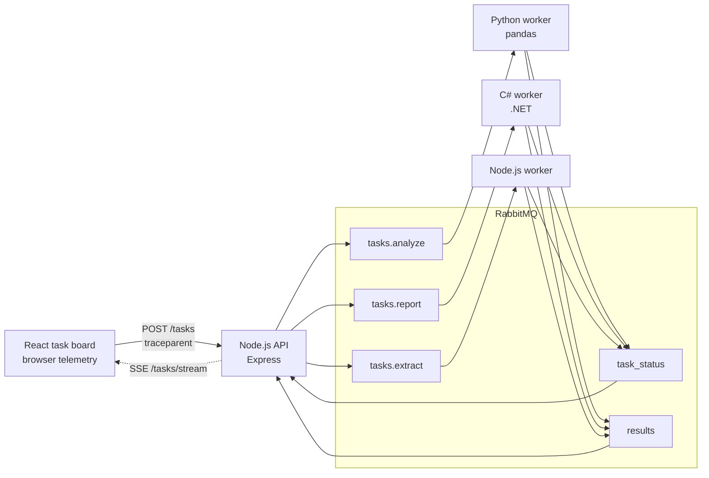

# Polyglot Task Queue


A back-office document pipeline: a Node.js API puts each document on a RabbitMQ work queue for its task type, and the worker written in the language best suited to the job picks it up. **Python** (pandas) analyzes sales datasets, **C#** turns meeting notes into structured reports, and **Node.js** extracts fields from emailed invoices. Results stream back to a React task board over server-sent events.

Every hop is traced with OpenTelemetry and the W3C trace context travels in the RabbitMQ message headers, so one click in the browser is one trace across the API, RabbitMQ and all three workers. Each service also publishes its own domain metrics and structured logs, and the API is documented with OpenAPI and Scalar.

## Architecture



| Task type | Queue | Worker | What it does |
| --- | --- | --- | --- |
| `analyze` | `tasks.analyze` | `worker-python` | Profiles a CSV dataset with pandas: totals, averages, the leading group and the period-over-period trend. |
| `report` | `tasks.report` | `worker-csharp` | Turns Markdown meeting notes into a structured report: sections, highlights, action items and reading time. |
| `extract` | `tasks.extract` | `worker-node` | Pulls invoice number, PO, dates, line items, total and vendor out of an emailed invoice. |

Each worker reports `processing` on the `task_status` queue and its outcome on the `results` queue. Every worker returns the same result envelope (`headline`, `facts`, `details`), whatever its language. The API keeps the latest tasks on an in-memory board (up to 500) and pushes changes to the UI.

## What This Demonstrates

- **addRabbitMQ**: Message broker with the management plugin
- **addNodeApp**: Express API and a Node.js worker, with OpenTelemetry preloaded through `NODE_OPTIONS`
- **addPythonApp + withUv**: Python worker with pandas
- **addDotnetProject**: C# worker using the Aspire RabbitMQ client integration
- **addViteApp**: React + TypeScript task board with browser telemetry
- **withOtlpExporter(HttpProtobuf)**: Node.js services and the browser export telemetry over OTLP/HTTP
- **withUrl / withUrlForEndpoint / withHttpCommand**: friendly dashboard links (**API**, **API reference (Scalar)**, **OpenAPI JSON**, **Task board**) and **Submit sample tasks** and **Simulate burst** buttons
- **waitFor + withHttpHealthCheck**: everything waits for RabbitMQ, and the API's `/health` reports its broker connection
- **Trace context propagation**: W3C `traceparent` in RabbitMQ message headers, injected and extracted by hand in JavaScript, Python and C#
- **Messaging semantic conventions**: the same span names and `messaging.*` attributes in all three languages
- **publishWithContainerFiles + addDockerComposeEnvironment**: the API serves the built UI in a Docker Compose deployment

## Running

```bash
aspire run
```

Open the **Task board** link on the `frontend` resource. Choose a task type, select **Use sample** and submit it, or select **Submit sample tasks** to send one document to each worker. On the `api` resource in the dashboard, **Submit sample tasks** does the same and **Simulate burst** queues 24 tasks at once.

## API endpoints

The `api` app exposes:

- `POST /tasks` - submit a document (`{ "type": "extract", "name": "invoice.txt", "data": "..." }`); `202 Accepted` with the queued task and its `traceId`.
- `GET /tasks?limit=100` / `GET /tasks/{taskId}` / `DELETE /tasks` - list, get or clear the board.
- `GET /tasks/stream` - server-sent events with a board snapshot whenever a task changes.
- `GET /tasks/samples` / `POST /tasks/samples` - list or queue the three sample documents.
- `POST /simulate/burst?tasks=24` - run mode only; the **Simulate burst** command.
- `GET /health`, `GET /openapi.json` and `GET /scalar`.

Errors are [RFC 9457](https://www.rfc-editor.org/rfc/rfc9457) problem details (`application/problem+json`) for `400`, `404`, `413` and `503`, and include the request's `traceId`.

## What to explore in the Aspire dashboard

### Resources and commands


- `api` links to **API**, **API reference (Scalar)** and **OpenAPI JSON**, and `frontend` to the **Task board**. `messaging` links to the **RabbitMQ Management UI**, where you can watch the queues.
- **Submit sample tasks** queues a sales CSV for Python, operations-review notes for C# and an emailed invoice for Node.js in one request, so one trace covers all three workers.
- **Simulate burst** (run mode) queues 24 tasks at once, eight per worker. Every 8th document is one its worker rejects (a CSV without numbers, notes that are too short, a delivery note instead of an invoice), so failures show up in traces, metrics and logs too. Each burst task starts its own trace, linked to the burst.

### Traces


One click on **Submit sample tasks** is one trace across five resources and four runtimes:

- `submit sample tasks` (browser) → `POST` (browser fetch, which adds `traceparent`) → `POST /tasks/samples` (api)
- → `publish tasks.analyze`, `publish tasks.report` and `publish tasks.extract` (api, PRODUCER) → `process tasks.*` in each worker (CONSUMER), parented to the API's publish span through the message headers
- → the domain span: `analyze dataset` (Python), `generate report` (C#) or `extract invoice fields` (Node.js), with attributes such as `taskqueue.dataset.rows`, `taskqueue.report.words` and `taskqueue.invoice.total`, and events such as `dataset.profiled`, `report.parsed` and `fields.extracted`
- → `publish task_status` and `publish results` (worker) → `process task_status` and `process results` back in the api, with a `task.completed` or `task.failed` event

Messaging spans carry `messaging.system`, `messaging.operation.type` (`send`/`process`), `messaging.operation.name`, `messaging.destination.name`, `messaging.rabbitmq.destination.routing_key`, `messaging.message.id`, `messaging.message.conversation_id` (the task id), `messaging.message.body.size` and `server.address`/`server.port`, in all three languages. The dashboard shows them as `MSG rabbitmq <queue>`. Every task returns its `traceId`, and the task board shows it, so you can search for a task's trace.

### Metrics


Each service has its own meter. The three workers publish the same instruments, so they're easy to compare:

| Meter | Instrument | Type | Unit | Attributes |
| --- | --- | --- | --- | --- |
| `TaskQueue.Api` | `taskqueue.tasks.submitted` | Counter | `{task}` | `taskqueue.task.type`, `taskqueue.task.source` (`api`, `sample`, `burst`) |
| `TaskQueue.Api` | `taskqueue.tasks.pending` | UpDownCounter | `{task}` | `taskqueue.task.type` |
| `TaskQueue.Api` | `taskqueue.task.turnaround` | Histogram | `s` | `taskqueue.task.type`, `taskqueue.task.outcome` |
| `TaskQueue.Worker.Python`, `.CSharp`, `.Node` | `taskqueue.tasks.processed` | Counter | `{task}` | `taskqueue.task.type`, `taskqueue.task.outcome` |
| | `taskqueue.task.duration` | Histogram | `s` | `taskqueue.task.type`, `taskqueue.task.outcome` |
| | `taskqueue.tasks.active` | UpDownCounter | `{task}` | `taskqueue.task.type` |
| | `taskqueue.tasks.failed` | Counter | `{task}` | `taskqueue.task.type`, `error.type` |
| `TaskQueue.Worker.Python` | `taskqueue.dataset.rows` | Histogram | `{row}` | |
| `TaskQueue.Worker.CSharp` | `taskqueue.report.words` | Histogram | `{word}` | |
| `TaskQueue.Worker.Node` | `taskqueue.extraction.fields` | Counter | `{field}` | `taskqueue.field.name` |

Attributes only use small, fixed sets of values; task ids and document names go on spans and logs. During a burst, `taskqueue.tasks.pending` climbs and drains as the workers catch up. The Node.js services also report HTTP and runtime metrics, and the C# worker .NET runtime metrics.

### Structured logs


Every service writes structured logs that the dashboard correlates by trace id, so filtering on one trace shows what each language logged for it:

- **api** and **worker-node**: [pino](https://getpino.io), bridged by the OpenTelemetry pino instrumentation. For example `Queued extract task task-0ad907d1 (northwind-invoice-INV-2026-0418.txt) on tasks.extract for worker-node` (`taskId`, `taskType`, `documentName`, `queue`, `worker`, `source`) and `Extracted 8 fields and 3 line items from ...` (`invoiceNumber`, `vendor`, `total`, `currency`, `fieldCount`).
- **worker-python**: the standard `logging` module with the OpenTelemetry logging handler; `extra={...}` fields become attributes (`task_id`, `document_name`, `rows`, `columns`, `measure`, `measure_total`).
- **worker-csharp**: `[LoggerMessage]` source-generated logging (`TaskId`, `DocumentName`, `ReportTitle`, `SectionCount`, `WordCount`, `ActionItemCount`).

Rejected documents log a warning with the error type, for example `Could not analyze customer-feedback-06.csv: The dataset has no numeric columns to analyze`.

### API reference


Open **API reference (Scalar)** on the `api` resource. The hand-written OpenAPI 3.1 document (`api/openapi.js`) has tags, summaries, descriptions, typed schemas, an example per task type and problem details responses, and Scalar can send requests to the running API.

## OpenTelemetry setup

- **API and Node.js worker**: `instrumentation.js` starts the Node.js SDK with OTLP/HTTP (protobuf) exporters for traces, metrics and logs, plus the pino and runtime instrumentations (and HTTP and Express in the API). The AppHost preloads it through `NODE_OPTIONS`. `messaging.js` creates the PRODUCER and CONSUMER spans and injects and extracts the trace context in the message headers.
- **Python worker**: `telemetry.py` sets up the OpenTelemetry SDK with OTLP exporters and the logging handler; `main.py` propagates the context with `opentelemetry.propagate`.
- **C# worker**: `Extensions.cs` (service defaults) exports the `TaskQueue.*` sources and meters. The RabbitMQ client's built-in tracing is turned off (`DisableTracing`) because its delivery spans start a new trace per message; `Messaging.cs` propagates the context with the OpenTelemetry propagator instead, like the other workers.
- **Browser**: `frontend/src/telemetry.ts` registers the web tracer with document-load and fetch instrumentation, and `frontend/src/lib/tracing.ts` wraps UI actions in spans. In run mode the Vite dev server receives the dashboard's OTLP/HTTP endpoint (`ASPIRE_DASHBOARD_OTLP_HTTP_ENDPOINT_URL` in `aspire.config.json`) and API key, and proxies the browser's same-origin `/otlp` requests to the dashboard, adding the key server-side (see `frontend/vite.config.ts`). Because `/tasks` is also same-origin, the fetch instrumentation adds `traceparent` without CORS. Browser telemetry is disabled in the published build.

## Commands

```bash
aspire run      # Run locally
aspire deploy   # Deploy to Docker Compose
aspire do docker-compose-down-dc  # Teardown deployment
```

## Security Notes

This sample is intended for local demo use. RabbitMQ messages are treated as trusted internal messages, and the public HTTP endpoints are unauthenticated.

The API validates input at the boundary: JSON bodies are limited to 64 KB, `type` must be `analyze`, `report` or `extract`, `data` is required and capped at 10,000 characters, `name` at 120 characters, `GET /tasks?limit=` at 500 and bursts at 100 tasks. The board keeps at most 500 tasks. The workers validate every message again, report documents they can't process as failed tasks, and drop malformed messages instead of requeueing them. The `/simulate/burst` endpoint only exists when the AppHost sets `ENABLE_BURST_SIMULATION` (run mode). Production services should add authentication and authorization, rate limits, a RabbitMQ retry and dead-letter policy, and persistent task storage.

Relevant references:

- [Node.js security best practices](https://nodejs.org/en/learn/getting-started/security-best-practices)
- [Express body parser limits](https://expressjs.com/en/resources/middleware/body-parser.html)
- [RabbitMQ consumer acknowledgements and publisher confirms](https://www.rabbitmq.com/docs/confirms)
- [RabbitMQ dead letter exchanges](https://www.rabbitmq.com/docs/dlx)
- [OWASP API Security Top 10](https://owasp.org/API-Security/editions/2023/en/0x11-t10/)

## Key Aspire Patterns

**RabbitMQ Setup** - Message broker with management UI:
```ts
const rabbitmq = await builder.addRabbitMQ("messaging")
    .withManagementPlugin()
    .withLifetime(ContainerLifetime.Persistent)
    .withUrlForEndpoint("management", async (url) =>
    {
        url.displayText = "RabbitMQ Management UI";
    });
```

**Node.js with OpenTelemetry over OTLP/HTTP** - Preload the SDK and inject the broker connection:
```ts
const api = await builder.addNodeApp("api", "./api", "index.js")
    .withEnvironment("NODE_OPTIONS", "--import ./instrumentation.js")
    .withOtlpExporter({ protocol: OtlpProtocol.HttpProtobuf })
    .waitFor(rabbitmq)
    .withReference(rabbitmq); // Injects MESSAGING_URI
```

**Dashboard commands** - Generate traffic without leaving the dashboard:
```ts
await api.withHttpCommand("/tasks/samples", "Submit sample tasks", {
    methodName: "POST",
    iconName: "DocumentQueueAdd",
    isHighlighted: true,
    resultMode: HttpCommandResultMode.Json,
});
```

**Trace context propagation** - The same pattern in each language:
```javascript
// Node.js - inject into the message headers when publishing
propagation.inject(context.active(), headers);
channel.sendToQueue(queue, body, { headers });

// ...and extract when consuming
const parent = propagation.extract(context.active(), msg.properties.headers, headerGetter);
tracer.startActiveSpan(`process ${queue}`, { kind: SpanKind.CONSUMER }, parent, handler);
```

```python
# Python - extract and continue the trace
parent = propagate.extract(message.headers or {}, getter=HEADER_GETTER)
with tracer.start_as_current_span(f"process {QUEUE}", context=parent, kind=SpanKind.CONSUMER):
    ...
```

```csharp
// C# - extract and continue the trace
var parent = Propagators.DefaultTextMapPropagator.Extract(default, properties.Headers, getter);
using var activity = ActivitySource.StartActivity($"process {Queue}", ActivityKind.Consumer, parent.ActivityContext);
```
