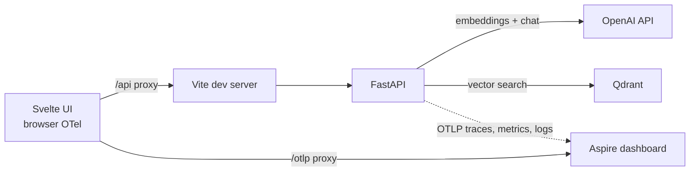
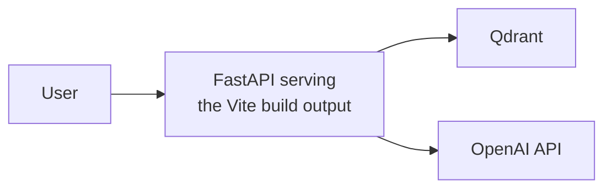

# RAG Document Q&A with Svelte

**A retrieval-augmented generation (RAG) app built with Svelte, FastAPI, Qdrant, and OpenAI, orchestrated and observed end to end with Aspire.**

*Contoso Handbook Q&A* answers employee questions from the company's policy documents: time off, hybrid work, travel and expenses, IT security, and onboarding. The API splits each document into section-sized chunks, embeds them into Qdrant, retrieves the closest passages for a question, and asks the model to answer only from those passages with numbered citations. The whole path is traced with OpenTelemetry: browser → FastAPI → embeddings → vector search → chat completion. The Aspire dashboard's GenAI visualizer shows the exact prompt, the retrieved sources, and the grounded answer.

![Aspire dashboard GenAI visualizer for the chat gpt-4.1-mini span of the question "How much parental leave do I get?", showing the numbered handbook sources sent as context, the question, and the answer with [1] and [3] citations, plus the duration and 510 tokens (light theme)](./images/rag-document-qa-svelte-genai-light.png#gh-light-mode-only)
![Aspire dashboard GenAI visualizer for the chat gpt-4.1-mini span of the question "How much parental leave do I get?", showing the numbered handbook sources sent as context, the question, and the answer with [1] and [3] citations, plus the duration and 510 tokens (dark theme)](./images/rag-document-qa-svelte-genai-dark.png#gh-dark-mode-only)

## Quick Start

### Prerequisites

- [Aspire CLI](https://aspire.dev/get-started/install-cli/)
- [Node.js](https://nodejs.org/) (for the TypeScript AppHost and the Svelte frontend)
- [Docker](https://docs.docker.com/get-docker/) (for Qdrant)
- [Python 3.11+](https://www.python.org/)
- [uv](https://github.com/astral-sh/uv)
- OpenAI API key (or any OpenAI-compatible endpoint, see below)

### Run

```bash
aspire run
```

When you run the app for the first time, Aspire prompts you for your OpenAI API key.

1. In the dashboard, run **Index sample documents** from the `api` resource (or select **Index sample documents** in the UI). This loads the five Contoso handbook documents in `api/sample_docs/`.
2. Open **Handbook Q&A** and ask a question, for example *"How much parental leave do I get?"*, *"What is the hotel limit for a trip to London?"*, or *"Can I paste customer data into an AI tool?"*.

You can also upload your own UTF-8 `.txt` policy. Use `## Section` headings so citations point at the right section.

### Using an OpenAI-compatible endpoint

To send requests through a gateway or proxy that speaks the OpenAI API (for example LiteLLM or a local server), set the `OpenAI:Endpoint` configuration value before you start. The endpoint must serve both `/chat/completions` and `/embeddings`:

```bash
OpenAI__Endpoint=http://localhost:4000/v1 aspire run
```

## Architecture

**Run mode:**



**Publish mode:**



The application consists of:

- **Aspire AppHost** (`apphost.mts`): models Qdrant, the OpenAI resource with `chat` and `embeddings` models, the uv-based FastAPI app, and the Vite frontend. Also adds a health check, dashboard links, and commands.
- **API** (`api/`): `main.py` (routes, OpenAPI, ProblemDetails), `rag.py` (chunking, indexing, retrieval, prompt building, domain telemetry), `qdrant_setup.py`, and `telemetry.py` (OpenTelemetry bootstrap).
- **Frontend** (`frontend/`): a Svelte 5 app with light and dark themes, a responsive layout, answers with clickable citations, and browser OpenTelemetry.


## Key Code

The AppHost references both models from the API and turns on GenAI message capture for local runs only:

```ts
const openai = await builder.addOpenAI("openai").withApiKey(openAiApiKey);
const chat = await openai.addModel("chat", "gpt-4.1-mini");
const embeddings = await openai.addModel("embeddings", "text-embedding-3-small");

const api = await builder.addUvicornApp("api", "./api", "main:app")
    .withUv()
    .withHttpHealthCheck({ path: "/health" })
    .waitFor(qdrant)
    .withReference(qdrant)
    .withReference(chat)                // CHAT_URI, CHAT_KEY, CHAT_MODELNAME
    .withReference(embeddings)          // EMBEDDINGS_URI, EMBEDDINGS_KEY, EMBEDDINGS_MODELNAME
    .withUrls(/* "API reference (Scalar)" and "OpenAPI JSON" links */)
    .withHttpCommand("/api/documents/samples", "Index sample documents", { methodName: "POST" })
    .withHttpCommand("/api/ask", "Ask a sample question", { /* POST a canned question */ });

if (await executionContext.isRunMode()) {
    await api.withEnvironment("OTEL_INSTRUMENTATION_GENAI_CAPTURE_MESSAGE_CONTENT", "span_only");
}

const frontend = await builder.addViteApp("frontend", "./frontend")
    .withReference(api)
    .withOtlpExporter({ protocol: OtlpProtocol.HttpProtobuf });

await api.publishWithContainerFiles(frontend, "public");
```

`api/telemetry.py` configures OpenTelemetry from the `OTEL_*` variables that Aspire injects. It exports traces, metrics, and logs over OTLP and instruments FastAPI, the OpenAI SDK (chat **and** embeddings), and HTTPX (the Qdrant client). `api/rag.py` adds a `rag.retrieve` span around each vector search:

```python
with tracer.start_as_current_span("rag.retrieve") as span:
    span.set_attributes({"db.system.name": "qdrant", "rag.retrieval.top_k": top_k})
    embedding = await openai.embeddings.create(model=embeddings_model, input=question)
    result = await qdrant.query_points(COLLECTION_NAME, query=embedding.data[0].embedding, limit=top_k)
    for rank, hit in enumerate(hits, start=1):
        span.add_event("rag.retrieval.hit", {"rag.chunk.id": hit.chunk.id, "rag.chunk.score": hit.score})
```

In the browser, `frontend/src/telemetry.js` registers the document-load and fetch instrumentations. The Vite dev server proxies `/otlp/*` to the dashboard and adds the OTLP API key server-side, so no secret reaches the browser. A click on **Ask** creates an `ask question` span. Its `fetch` call injects `traceparent`, so the server spans join the same trace.

Key features:

- **RAG pattern**: section-aware chunking → batched embeddings → Qdrant cosine search → a grounded chat completion that cites numbered sources. The UI marks which retrieved chunks the answer actually cited.
- **OpenAI resource + two models**: `addOpenAI(...).addModel(...)` for chat and embeddings, with a secret API key parameter.
- **GenAI observability**: [GenAI semantic-convention](https://opentelemetry.io/docs/specs/semconv/gen-ai/) spans and metrics for chat and embeddings via `opentelemetry-instrumentation-openai-v2`, plus custom `Contoso.DocumentQA` spans and metrics.
- **End-to-end browser tracing**: one trace from the Svelte click to the model call.
- **OpenAPI + Scalar**: a documented API with tags, examples, and RFC 9457-style `ProblemDetails` errors, browsable at `/scalar`.
- **Health check and dashboard commands**: `/health` drives the resource's health. The dashboard can index the sample documents, ask a sample question, or clear the index.
- **`publishWithContainerFiles`**: in publish mode the API serves the built frontend.

## What to explore in the Aspire dashboard

- **Resources**: `api` reports *Healthy* once `/health` responds. Its URLs include **API reference (Scalar)** and **OpenAPI JSON**. From the resource's actions, run **Index sample documents**, **Ask a sample question** (the JSON answer with citations opens in the dashboard), or **Clear index**.

  
  

- **Traces**: open an `ask question` trace from `frontend` to follow one question across every tier:

  ```text
  ask question                          (frontend, browser)
  └─ HTTP POST                          (frontend, fetch)
     └─ POST /api/ask                   (api; rag.answer.grounded, rag.citation.count)
        ├─ rag.retrieve                 (top_k, chunk ids, scores; one rag.retrieval.hit event per chunk)
        │  ├─ embeddings text-embedding-3-small
        │  └─ HTTP POST                 (Qdrant query)
        └─ chat gpt-4.1-mini
  ```

  Indexing produces `rag.index_document` spans with one batched `embeddings` call per document.

  
  

- **GenAI visualizer**: select the **GenAI details** (sparkle) button on a `chat` span to see the system instructions, the numbered sources sent to the model, the question, the cited answer, and token usage. The `embeddings` spans show the embedding model and input token counts.
- **Metrics** (`api`):
  - `gen_ai.client.token.usage` and `gen_ai.client.operation.duration`: input/output tokens and latency per chat and embeddings call.
  - `document_qa.questions.answered` (by `rag.answer.grounded`): questions answered, and whether the answer cited a source.
  - `document_qa.retrieval.duration` and `document_qa.retrieval.top_score`: retrieval latency and best similarity score per question.
  - `document_qa.documents.indexed` (by `rag.index.source`) and `document_qa.index.chunks`: indexing volume and the current size of the index.
  - `http.server.request.duration`: API latency by route.

  
  

- **Structured logs**: each log is correlated to its trace. Answer logs carry `rag.retrieval.top_k`, `rag.retrieval.top_score`, `rag.citation.chunk_ids`, `rag.answer.grounded`, `gen_ai.request.model`, and token counts. Indexing logs carry `rag.document.name` and `rag.chunk.count`.

> [!IMPORTANT]
> Message content capture (`OTEL_INSTRUMENTATION_GENAI_CAPTURE_MESSAGE_CONTENT`) records questions, retrieved document text, and answers in telemetry. The AppHost enables it only for local runs. Leave it off wherever documents or questions may contain confidential data.

## Accessing the Application

### 1. Web UI

Open the **Handbook Q&A** link for `frontend` in the dashboard. Pick a suggestion or type a question. Select a citation chip in the answer to highlight its source chunk. Use the theme button in the header to switch between light and dark.

### 2. REST API

Browse and try the API in **Scalar** at `/scalar` (raw document at `/openapi.json`):

- `POST /api/ask`: ask a question and get the answer, citations with scores, the model, and token usage
- `GET /api/documents`: list indexed documents and chunk counts
- `POST /api/documents`: upload and index a `.txt` document
- `POST /api/documents/samples`: index the sample handbook documents
- `DELETE /api/documents`: clear the index
- `GET /health`: health check


## Security Notes

This is a local-first sample, not a production-ready document service. Uploaded documents are untrusted input and the API only accepts UTF-8 `.txt` text uploads with size, chunk, question length, and per-client rate limits to reduce accidental OpenAI cost or quota burn.

RAG apps can be affected by prompt injection and data disclosure risks because retrieved document text is placed into model context. The sample does not provide tenant isolation, per-document access control, malware/content scanning, or durable data-retention policies.

Before adapting this for production, add real authentication and authorization, data retention and deletion workflows, monitoring, and malware/content scanning as appropriate for your data. Relevant references include [FastAPI security](https://fastapi.tiangolo.com/tutorial/security/), [OWASP LLM01 Prompt Injection](https://genai.owasp.org/llmrisk/llm01-prompt-injection/), [OWASP LLM02 Sensitive Information Disclosure](https://genai.owasp.org/llmrisk/llm022025-sensitive-information-disclosure/), [OWASP LLM08 Vector and Embedding Weaknesses](https://genai.owasp.org/llmrisk/llm082025-vector-and-embedding-weaknesses/), and OpenAI's [production best practices](https://developers.openai.com/api/docs/guides/production-best-practices) and [safety best practices](https://developers.openai.com/api/docs/guides/safety-best-practices).
