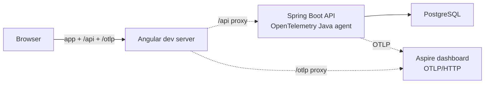

# Spring Petclinic with Angular, Spring Boot, and PostgreSQL


A Petclinic front desk built with the official Aspire Java hosting integration and a TypeScript AppHost.
Receptionists book pets into 30-minute visits, and the Spring Boot API assigns the first free vet with
the right specialty: general practice, dentistry, radiology, or surgery. When nobody is free, the API
answers with RFC 9457 problem details that suggest the next free slot. One click in the Angular app is
one trace through the browser, the Spring Boot API, and PostgreSQL.

## Architecture



- **frontend**: an Angular 21 front desk with Angular Material (light and dark themes). It shows a five-day
  visit schedule, a booking form, and the owner and pet directory, and can check out, cancel, and register.
  In run mode the browser sends its own OpenTelemetry traces.
- **api**: a Spring Boot 4 REST API with Spring Data JPA. It's documented with springdoc OpenAPI and Scalar,
  returns problem details for every error, and adds domain spans, the `Petclinic.Api` meter, and structured
  logs on top of the OpenTelemetry Java agent's automatic instrumentation.
- **postgres**: an Aspire-managed PostgreSQL server with the `petclinic` database.

## What this demonstrates

- `addJavaApp` with Maven and Spring Boot, and `withWrapperPath` for a cross-platform Maven wrapper
- `withOtelAgentDefaultPath` running the API with the OpenTelemetry Java agent that Maven copies next to the build
- PostgreSQL JDBC URL and credentials supplied through Aspire expressions, with `waitFor` and HTTP health checks
- `withUrl` links to **API reference (Scalar)** and **OpenAPI JSON**, and friendly **API** and **Front desk** link names
- `withHttpCommand` buttons, **Seed sample visits** and **Simulate clinic traffic**, backed by run-mode-only endpoints
- `withOtlpExporter(OtlpProtocol.HttpProtobuf)` so the Angular dev server can forward browser spans to the dashboard
- Domain spans, a domain meter, and Logback logs with key-value attributes, all correlated in the dashboard
- A TypeScript AppHost orchestrating Java, TypeScript, and a container resource

## Prerequisites

- Aspire CLI **17.0.0**, installed using the [root installation instructions](../../README.md#aspire-version)
- Java Development Kit 21 or later
- Node.js 20.19, 22.13, or 24 or later
- Docker Desktop or another Docker-compatible container runtime

Follow the [root installation instructions](../../README.md#aspire-version) to install
the matching CLI. The CLI/SDK and other integrations target `17.0.0`, while the
Java integration uses `17.0.0-preview.1.26567.5` because it has no stable 17.0.0
package yet. Packages restore from NuGet.org; no staging feed is configured.

## Run

From this sample's directory:

```bash
aspire start
```

Open **Front desk** on the `frontend` resource in the Aspire dashboard. The AppHost starts PostgreSQL,
builds the API and copies its pinned OpenTelemetry agent, waits for the database to become ready, starts
the Spring Boot API, and then starts Angular. On first start the API registers ten owners, thirteen pets,
and six vets, and books a five-day sample schedule.

Book a visit by choosing an owner, a pet, a reason, a date, and a time. Leave **Vet** set to
**First free vet** to let the clinic pick one. Ask for a busy slot, such as a second dental cleaning at the
same time as another, and the form shows the API's problem details with a button that books the suggested
slot instead.

## API endpoints

| Method | Path | Description |
| --- | --- | --- |
| `GET` | `/api/stats` | Owner, pet, and vet totals, today's visits, and upcoming visits |
| `GET` | `/api/owners?lastName=` | Owners and their pets, optionally filtered by a last-name prefix |
| `GET` | `/api/owners/{ownerId}` | One owner and their pets |
| `POST` | `/api/owners` | Register an owner (`409` when the same name and telephone already exist) |
| `POST` | `/api/owners/{ownerId}/pets` | Add a pet (`409` when the owner already has a pet with that name) |
| `GET` | `/api/visits?from=&days=` | The visit schedule for 1–31 days |
| `POST` | `/api/owners/{ownerId}/pets/{petId}/visits` | Book a visit (`409` with `nextAvailableSlot` when no matching vet is free) |
| `POST` | `/api/visits/{visitId}/complete` | Check a pet out |
| `POST` | `/api/visits/{visitId}/cancel` | Cancel a visit |
| `GET` | `/api/vets` | The veterinary team and their specialties |
| `GET` | `/api/visit-reasons` | The reasons a visit can be booked for, and the specialty each one needs |

Visits start on the hour or half hour between 08:00 and 17:30, in the future, and at most 60 days ahead.
Every error is `application/problem+json` with a `type`, `title`, `detail`, the request path as `instance`,
and the request's `traceId`. Validation problems list each invalid field under `errors`:

```json
{
  "type": "https://petclinic.example/problems/slot-unavailable",
  "title": "Slot unavailable",
  "status": 409,
  "detail": "No dentistry vet is free on Sat, Nov 28 at 10:30. The next free slot is Sat, Nov 28 at 11:00.",
  "instance": "/api/owners/3/pets/3/visits",
  "nextAvailableSlot": "2026-11-28T11:00:00",
  "traceId": "d85d2430b533767112ccc5b895bebdb7"
}
```

## What to explore in the Aspire dashboard

### Resources and commands


- `api-maven-build` builds the API and copies the OpenTelemetry Java agent before `api` starts.
- The `api` resource links to **API**, **API reference (Scalar)**, and **OpenAPI JSON**, and its actions add two commands:
  - **Seed sample visits** replaces the upcoming schedule with five days of realistic visits, for example
    `{"removed":31,"booked":28,"skipped":0}`.
  - **Simulate clinic traffic** registers a walk-in owner and their pet, books visits (including a
    double-booked dentist and a request before opening time), checks out past-due visits, and cancels one,
    for example `{"ownersRegistered":1,"duplicateOwners":0,"visitsBooked":6,"slotConflicts":2,"invalidRequests":1,"visitsCompleted":0,"visitsCancelled":1,"durationMs":112}`.
    Each simulated action is its own trace, linked to the command's request.
- The `frontend` resource links to the **Front desk**.

### Traces


Booking a visit in the front desk produces one trace across `frontend`, `api`, and `postgres`:

- `book visit` (browser) → `HTTP POST` (browser fetch, which adds `traceparent`) → `POST /api/owners/{ownerId}/pets/{petId}/visits` (api)
- → `book visit`, with `petclinic.owner.id`, `petclinic.pet.id`, `petclinic.pet.name`, `petclinic.pet.species`,
  `petclinic.visit.reason`, `petclinic.visit.starts_at`, `petclinic.vet.id`, `petclinic.vet.specialty`,
  `petclinic.visit.id`, and `petclinic.booking.outcome`, plus a `visit.booked` event (or a `request.rejected`
  event with the problem type and detail)
- → `find available vet`, with `petclinic.vet.specialty`, `petclinic.vets.considered`, and
  `petclinic.visit.next_available_slot` when the slot is taken, plus a `vet.busy` event for each busy vet and a
  `vet.assigned` event
- → the agent's Spring Data repository, Hibernate, and JDBC spans, down to each PostgreSQL statement.

Checking out, cancelling, registering an owner, and loading the page are traced the same way, as
`complete visit`, `cancel visit`, `register owner`, and `load front desk`. Page loads also produce
`documentLoad` traces with resource timings.

### Metrics


The `Petclinic.Api` meter publishes:

| Instrument | Type | Unit | Attributes |
| --- | --- | --- | --- |
| `petclinic.visits.booked` | Counter | `{visit}` | `petclinic.visit.reason`, `petclinic.pet.species` |
| `petclinic.visit.booking.duration` | Histogram | `s` | `petclinic.booking.outcome` |
| `petclinic.visits.scheduled` | UpDownCounter | `{visit}` | `petclinic.vet.specialty` |
| `petclinic.owners.registered` | Counter | `{owner}` | |

Metric attributes only use small, fixed sets of values; owner, pet, and visit IDs go on spans and logs. The booking
duration is recorded inside the `book visit` span, so its exemplars link to the trace. The Java agent also reports
HTTP server, JVM runtime, and HikariCP connection pool metrics.

### Structured logs


The API logs with SLF4J's fluent API, for example
`log.atInfo().addKeyValue("petclinic.visit.id", id).log("Booked ...")`. The Java agent's Logback bridge sends every
entry to the dashboard with its trace and span IDs, and the AppHost sets
`OTEL_INSTRUMENTATION_LOGBACK_APPENDER_EXPERIMENTAL_CAPTURE_KEY_VALUE_PAIR_ATTRIBUTES=true` so the key-value pairs
become attributes. Look for `Booked dental cleaning for Rosy the dog with Dr. Linda Douglas ...`,
`Registered owner ...`, and warnings such as `No dentistry vet is free on ...; next free slot ...`.

### API reference


Open **API reference (Scalar)** on the `api` resource. springdoc generates the OpenAPI 3.1 document at
`/v3/api-docs` from the controllers: tags, operation summaries and descriptions, typed schemas with examples,
example requests, and example problem details for each `400`, `404`, and `409`. Scalar and its JavaScript bundle are
served by the Spring Boot API, and **Test Request** calls the running API.

## OpenTelemetry setup

- **API**: Maven copies the pinned Java agent to `api/target/agent/opentelemetry-javaagent.jar`, and
  `withOtelAgentDefaultPath()` makes Aspire run that build before launching the API. The Java integration supplies
  the OTLP endpoint and authentication settings, so there's no collector or hardcoded endpoint. The agent traces
  Spring MVC, Spring Data, Hibernate, and JDBC and bridges Logback. The app's own spans and meter
  (`ClinicTelemetry.java`) use only the OpenTelemetry API, which the agent connects to its SDK; without the agent,
  for example in tests, they're no-ops.
- **Browser**: `frontend/src/telemetry.ts` registers the web tracer with document-load and fetch instrumentation, and
  `frontend/src/app/tracing.ts` wraps UI actions in spans. The AppHost gives the Angular resource the dashboard's
  OTLP/HTTP endpoint (`ASPIRE_DASHBOARD_OTLP_HTTP_ENDPOINT_URL` in `aspire.config.json`) and API key.
  `frontend/proxy.conf.cjs` serves the non-secret settings at `/otel-config.json` and forwards the browser's
  same-origin `/otlp` requests to the dashboard, adding the API key server-side. Because `/api` is also
  same-origin, the fetch instrumentation adds `traceparent` without CORS. Browser telemetry is run-mode only:
  production builds never load the SDK.

## Project layout

- `apphost.mts` - TypeScript AppHost and resource graph
- `api` - Spring Boot REST API using Spring Data JPA, springdoc OpenAPI, and the OpenTelemetry API
- `frontend` - Angular single-page application with Angular Material

On Windows, `api/tools/run-mvnw.cmd` preserves the wrapper's directory-qualified path.
The helper invokes `.\mvnw.cmd` explicitly so Windows resolves it from the working directory.

Run the API tests with `./mvnw test` (or `.\mvnw.cmd test` on Windows) from the `api` directory.

## Security notes

This is a trusted local demo, not a production template. Its HTTP endpoints have no
application authentication or transport encryption. Anyone who can reach the API can
read all owner records, register owners and pets, and book or cancel visits. Do not publicly
expose or forward these endpoints; the Angular development server listens on all interfaces (`0.0.0.0`).
The `/demo/seed` and `/demo/simulate` endpoints are only enabled in run mode, when the AppHost sets
`PETCLINIC_DEMO_ENABLED=true`.

Use synthetic data only. PostgreSQL uses Aspire-generated development credentials,
has no persistent volume configured, and should be treated as disposable. Hibernate
automatically updates the database schema (`spring.jpa.hibernate.ddl-auto=update`).
Before adapting this sample for production, add authentication, authorization,
transport encryption, request-rate controls, and production secret management.
