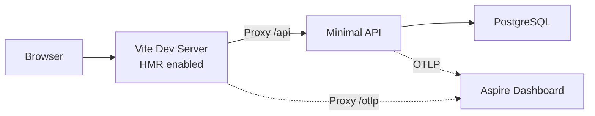
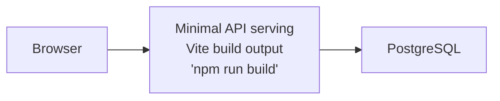

# ASP.NET Core Minimal API + PostgreSQL + Vite

**Contoso Service Desk**, an IT help-desk request queue built with a C# Minimal API, Entity Framework Core, PostgreSQL, and a React + TypeScript frontend. Employees raise requests for hardware, software, access and network problems. Agents pick them up and resolve them against a priority-based SLA (Critical 4 h, High 8 h, Medium 24 h, Low 72 h). Resolving a request nobody has picked up is rejected with `409 Conflict`.

One click in the browser becomes one trace: the React app's span, its `fetch`, the API's server span, `servicedesk.*` domain spans, and the PostgreSQL commands EF Core runs. The `Contoso.ServiceDesk` meter and `[LoggerMessage]` structured logs land in the Aspire dashboard next to it, and the API is documented with OpenAPI and Scalar.


## Architecture

**Run Mode:**


**Publish Mode:**


## What This Demonstrates

- **addDotnetProject**: ASP.NET Core Minimal API with EF Core, `TypedResults`, and RFC 9457 problem details for 400, 404 and 409
- **addViteApp + withOtlpExporter(HttpProtobuf)**: React + TypeScript frontend with browser telemetry (document load, fetch, and UI action spans)
- **addPostgres**: PostgreSQL database with pgAdmin and a persistent data volume
- **AddNpgsqlDbContext**: Connection string injection, health check, retries, and Npgsql traces and metrics
- **withUrl / withHttpCommand**: "API reference (Scalar)" and "OpenAPI JSON" links, plus "Seed sample data" and "Simulate traffic" buttons on the API resource
- **ActivitySource, Meter and [LoggerMessage]**: `servicedesk.*` domain spans, the `Contoso.ServiceDesk` meter, and structured logs correlated with traces
- **publishWithContainerFiles**: Frontend embedded in the API's wwwroot for publish mode
- **waitFor**: PostgreSQL starts before the API, and the API before the frontend

## Running

```bash
aspire run
```

Open **Service desk UI** on the `frontend` resource. If the queue is empty, choose **Seed sample data** on the `api` resource. Requests are kept in the PostgreSQL data volume between runs.

## What to explore in the Aspire dashboard

- **Resources and commands**: the `api` resource links to **API reference (Scalar)** and **OpenAPI JSON**. Its actions include **Seed sample data** (replace the queue with 17 realistic requests, some overdue and some recently resolved) and **Simulate traffic** (employees raise requests, agents pick up and resolve the most urgent ones, and one invalid move is rejected). Both return a JSON summary of the queue. The `postgres` resource links to pgAdmin.

  
  

- **Traces**: click **Pick up**, **Resolve** or **Reopen** on a request. The trace starts in the `frontend` (browser) with a `resolve request` span and its `PATCH` fetch, then crosses into the API's `PATCH /api/requests/{id:int}` span, the `servicedesk.update_request` and `servicedesk.transition` domain spans, and the `postgresql` spans for the `SELECT` and `UPDATE`. The follow-up `GET /api/queue/summary` joins the same trace. Domain spans carry `servicedesk.request.id`, `servicedesk.request.priority`, `servicedesk.transition.from`/`to`, `servicedesk.request.resolution_hours` and `servicedesk.sla.outcome`, with `request.status_changed`, `request.assigned`, `request.sla_breached`, `request.reopened` and `transition.rejected` events. Page loads appear as `documentLoad` traces.

  
  

- **Metrics**: the `Contoso.ServiceDesk` meter on the `api` resource publishes:
  - `servicedesk.requests.created`: requests raised, by `servicedesk.request.category` and `servicedesk.request.priority`
  - `servicedesk.request.transitions`: status changes, by `servicedesk.transition.from`, `servicedesk.transition.to` and `servicedesk.transition.outcome` (`accepted` or `rejected`)
  - `servicedesk.request.resolution_time`: histogram of hours from raised to resolved, by priority and `servicedesk.sla.outcome` (`met` or `breached`)
  - `servicedesk.requests.open`: up-down counter of open requests, by priority

  The `Npgsql` meter adds connection pool and command metrics.

  
  

- **Structured logs**: `[LoggerMessage]` logs (`api/Log.cs`) such as `Request SR-1042 'Laptop battery drains in under two hours' raised by Hannah Lee (High Hardware, …)`, `Request SR-1042 picked up by Kenji Watanabe after 2.4 h in the queue`, a warning when a request is resolved past its SLA, and a warning for each rejected move. Fields such as `ServiceRequestId`, `Priority`, `Category`, `AssignedTo`, `ResolutionHours`, `OverdueHours`, `FromStatus` and `ToStatus` become log attributes, and each entry links to its trace.

  
  

- **API reference**: open **API reference (Scalar)** on the `api` resource. Every operation has a summary, a description, typed request and response schemas with examples, and `application/problem+json` examples for 400, 404 and 409. The raw document is at `/openapi/v1.json`.

  
  

### Browser telemetry

In run mode the Vite resource receives the dashboard's OTLP/HTTP endpoint (`ASPIRE_DASHBOARD_OTLP_HTTP_ENDPOINT_URL` in `aspire.config.json`) and API key. The browser posts spans to the same-origin `/otlp` path, and the Vite dev server proxies them to the dashboard, adding the API key server-side (see `frontend/vite.config.ts`). Because `/api` is also same-origin, the fetch instrumentation adds `traceparent` without any CORS configuration. Browser telemetry is disabled in the published static build.

## Security Notes

This sample is intentionally small and demo-focused. The service desk endpoints under `/api/requests` and `/api/queue` are public and unauthenticated, and the app does not add authentication, authorization, CSRF protection, or rate limiting. `GET /api/requests` applies bounded pagination with `offset` and `limit` query parameters, defaulting to 50 requests and capping responses at 100. Titles are limited to 200 characters and names to 80.

The `/api/demo/seed` and `/api/demo/simulate` endpoints, the OpenAPI document and Scalar are mapped only in the Development environment (run mode). The PostgreSQL pgAdmin container is included as local demo tooling. Do not expose pgAdmin or these unauthenticated endpoints directly in production.

For production deployments, review the [ASP.NET Core security overview](https://learn.microsoft.com/aspnet/core/security/), add appropriate authentication and authorization, keep request validation in place using [ASP.NET Core minimal API parameter validation](https://learn.microsoft.com/aspnet/core/fundamentals/minimal-apis/parameter-binding?view=aspnetcore-10.0#parameter-validation), add [rate limiting](https://learn.microsoft.com/aspnet/core/performance/rate-limit), use [antiforgery APIs](https://learn.microsoft.com/aspnet/core/security/anti-request-forgery) when browser clients rely on cookies, and evaluate the [OWASP API Security Top 10](https://owasp.org/API-Security/editions/2023/en/0x11-t10/).

## Commands

```bash
aspire run      # Run locally
aspire deploy   # Deploy to Docker Compose
aspire do docker-compose-down-dc  # Teardown deployment
```

## Key Aspire Patterns

**Container Files Publishing** - Frontend embedded in API's wwwroot:
```ts
const postgres = await builder.addPostgres("postgres")
    .withDataVolume()
    .withLifetime(ContainerLifetime.Persistent)
    .withPgAdmin({
        configureContainer: async (pgAdmin) =>
        {
            await pgAdmin.withLifetime(ContainerLifetime.Persistent);
        }
    });

const db = await postgres.addDatabase("servicedesk");

const api = await builder.addDotnetProject("api", "./api/Api.csproj", { launchProfileName: "https" })
    .withHttpHealthCheck({ path: "/health" })
    .withExternalHttpEndpoints()
    .waitFor(db)
    .withReference(db);

const frontend = await builder.addViteApp("frontend", "./frontend")
    .withReference(api)
    .waitFor(api)
    .withOtlpExporter({ protocol: OtlpProtocol.HttpProtobuf })
    .withUrl("", { displayText: "Service desk UI" });

await api.publishWithContainerFiles(frontend, "wwwroot");
```

**Dashboard links and commands** - Dev-only buttons on the API resource:
```ts
const apiEndpoint = await api.getEndpoint("https");
await api
    .withUrl(refExpr`${apiEndpoint}/scalar`, { displayText: "API reference (Scalar)" })
    .withHttpCommand("/api/demo/simulate", "Simulate traffic", {
        methodName: "POST",
        iconName: "ArrowSync",
        resultMode: HttpCommandResultMode.Json,
    });
```

**EF Core Integration** - Automatic connection string injection, plus Npgsql traces and metrics:
```csharp
builder.AddNpgsqlDbContext<ServiceDeskDbContext>("servicedesk");
```

**Domain telemetry** - One `ActivitySource` and `Meter`, registered with a `Contoso.*` wildcard in `Extensions.cs`:
```csharp
using var activity = ServiceDeskTelemetry.ActivitySource.StartActivity("servicedesk.transition");
// ... change the status and SaveChangesAsync(), so the SQL spans nest under this span
telemetry.RequestResolved(request.Priority, hours, slaMet);
logger.RequestResolvedLate(request.Id, request.AssignedTo, hoursOpen, overdueHours, request.Priority);
```

**Static File Serving** - API serves embedded frontend in publish mode:
```csharp
app.UseFileServer(); // Serves wwwroot/index.html and assets
```