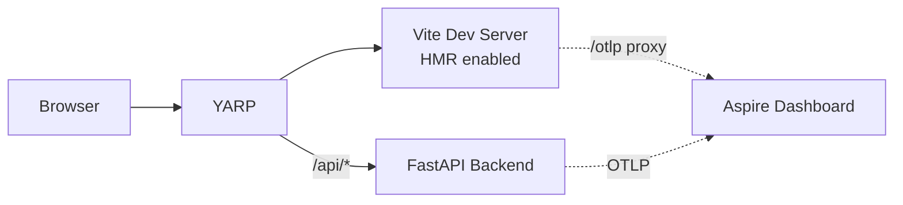
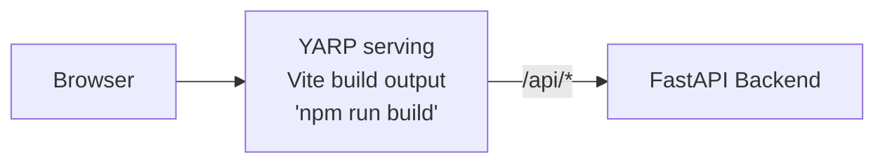

# Vite React + FastAPI

A team task board ("Contoso Task Board") with a React frontend and a Python FastAPI backend behind YARP. A platform team triages tasks with a priority, assignee and due date, and moves them across **To do → In progress → Blocked → Done**. Blocked work can't jump straight to done (the API answers `409 Conflict` with a problem details body).

The sample is fully instrumented with OpenTelemetry: browser spans, YARP proxy spans, FastAPI server spans, custom `taskboard.*` domain spans, `Contoso.TaskBoard` metrics, and Python structured logs all land in the Aspire dashboard, correlated by trace id. The API is documented with OpenAPI and Scalar.


## Architecture

**Run Mode:**


**Publish Mode:**


## What This Demonstrates

- **addUvicornApp**: Python FastAPI backend with OpenTelemetry traces, metrics and logs (`api/telemetry.py`)
- **withUrl / withHttpCommand**: Scalar and OpenAPI links plus "Seed sample data" and "Simulate traffic" buttons on the API resource
- **addViteApp + withOtlpExporter(HttpProtobuf)**: React frontend with browser telemetry (document load + fetch spans)
- **addYarp**: Single endpoint with path-based routing
- **withTransformPathRemovePrefix**: Strip `/api` prefix before forwarding
- **publishWithStaticFiles**: Frontend embedded in YARP for publish mode
- **Dual-Mode Operation**: Vite HMR in run mode, Vite build output in publish mode
- **Polyglot Fullstack**: JavaScript + Python working together

## Running

```bash
aspire run
```

The `app` (YARP) resource uses explicit start: start it from the dashboard, then open its URL. Choose **Seed sample data** on the `api` resource to fill the board.

## Commands

```bash
aspire run      # Run locally
aspire deploy   # Deploy to Docker Compose
aspire do docker-compose-down-dc  # Teardown deployment
```

## What to explore in the Aspire dashboard

- **Resources**: the `api` resource links to **API reference (Scalar)** and **OpenAPI JSON**. Its actions include **Seed sample data** (replace the board with a dozen realistic tasks) and **Simulate traffic** (new tasks arrive, get picked up, blocked and completed, and one blocked → done move is rejected). Both return a JSON summary.

  
  

- **Traces**: click **Start**, **Done** or **Block** on a card. The `move task` trace starts in the `frontend` (browser) and flows through the fetch span, the YARP `PATCH api/{**catch-all}` proxy span and the FastAPI `PATCH /tasks/{task_id}` span to the `taskboard.update_task` and `taskboard.transition` domain spans. Domain spans carry `taskboard.task.id`, `taskboard.task.priority`, `taskboard.transition.from`/`to` and `taskboard.task.lead_time_hours`, with `task.status_changed`, `task.overdue` and `transition.rejected` events. Page loads appear as `documentLoad` traces.

  
  

- **Metrics**: the `Contoso.TaskBoard` meter publishes:
  - `taskboard.tasks.created`: tasks added, by `taskboard.task.priority`
  - `taskboard.task.transitions`: status changes, by `taskboard.transition.from` and `taskboard.transition.to`
  - `taskboard.task.lead_time`: histogram of hours from creation to done, by priority
  - `taskboard.tasks`: up-down counter of tasks on the board, by `taskboard.task.status`

  
  

- **Structured logs**: the `contoso.taskboard` logger writes entries such as `Completed task 7 'Draft postmortem…' in 52.3 h` and a warning for each rejected blocked → done move. The `extra={...}` fields (`taskboard.task.id`, `taskboard.task.priority`, `taskboard.transition.to` and others) become log attributes, and each entry links to its trace.

  
  

- **API reference**: open **API reference (Scalar)** on the `api` resource. Every operation has a summary, description, typed request/response schemas and `application/problem+json` examples for 404, 409 and 422.

  
  

### Browser telemetry

In run mode the Vite resource receives the dashboard's OTLP/HTTP endpoint (`ASPIRE_DASHBOARD_OTLP_HTTP_ENDPOINT_URL` in `aspire.config.json`) and API key. The browser posts spans to the same-origin `/otlp` path, which YARP forwards to the Vite dev server, which proxies to the dashboard and adds the API key server-side (see `frontend/vite.config.js`). Because `/api` is also same-origin, the fetch instrumentation adds `traceparent` without CORS. Browser telemetry is disabled in the published static build.

In run mode the AppHost also sets `YARP_UNSAFE_OLTP_CERT_ACCEPT_ANY_SERVER_CERTIFICATE` on the YARP container, because it doesn't trust the local dashboard's development certificate. Without it, YARP's proxy spans are dropped and the trace goes straight from the browser to the API.

## Key Aspire Patterns

**YARP with Path Transform** - Strip `/api` prefix before forwarding to FastAPI:
```ts
const api = await builder.addUvicornApp("api", "./api", "main:app")
    .withHttpHealthCheck({ path: "/health" });

const frontend = await builder.addViteApp("frontend", "./frontend")
    .withReference(api)
    .withOtlpExporter({ protocol: OtlpProtocol.HttpProtobuf });

await builder.addYarp("app")
    .withConfiguration(async (yarp) =>
    {
        const apiCluster = await (await yarp.addClusterWithDestination("api", "https://api"))
            .withHttpClientConfig({ dangerousAcceptAnyServerCertificate: true });
        await (await yarp.addRoute("api/{**catch-all}", apiCluster))
            .withTransformPathRemovePrefix("/api");

        if (isRunMode)
        {
            const frontendCluster = await yarp.addClusterFromResource(frontend);
            await yarp.addRoute("{**catch-all}", frontendCluster);
        }
    })
    .withReference(api)
    .publishWithStaticFiles(frontend);
```

**Path Transform Example**:
- Client: `PATCH /api/tasks/7`
- YARP receives: `/api/tasks/7`
- Transform strips: `/api`
- FastAPI receives: `PATCH /tasks/7`

**Dashboard commands** - Dev-only buttons on the API resource:
```ts
await api
    .withEnvironment("ENABLE_DEMO_ENDPOINTS", "true")
    .withHttpCommand("/demo/seed", "Seed sample data", {
        methodName: "POST",
        resultMode: HttpCommandResultMode.Json,
    });
```

## Security Notes

This sample intentionally keeps the FastAPI task endpoints public and unauthenticated for instructional use. The `/api/tasks` endpoints are demo endpoints, not a production API security model.

- Task data is stored in process memory and is lost when the API restarts. The API caps the board at 100 tasks, limits titles to 200 characters and assignee names to 60, requires non-empty titles, and bounds list responses with `skip` and `limit` query parameters.
- The `/demo/seed` and `/demo/simulate` endpoints exist only when the AppHost sets `ENABLE_DEMO_ENDPOINTS` (run mode).
- The sample does not include authentication, authorization, CSRF protection, or rate limiting.
- For production, add an appropriate identity provider and authorization checks, persistent storage, CSRF protections if browser credentials are used, rate limiting/quotas, request logging/monitoring, and deployment-specific network protections.

Relevant references:

- [FastAPI security](https://fastapi.tiangolo.com/tutorial/security/)
- [FastAPI request body and field validation](https://fastapi.tiangolo.com/tutorial/body-fields/)
- [OWASP API Security Top 10](https://owasp.org/API-Security/editions/2023/en/0x11-t10/)
